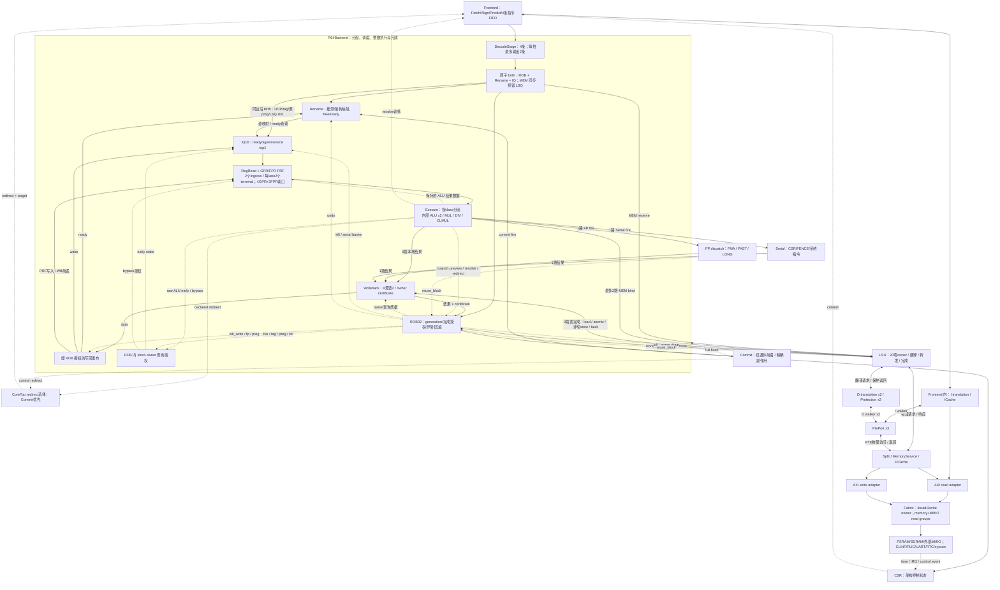
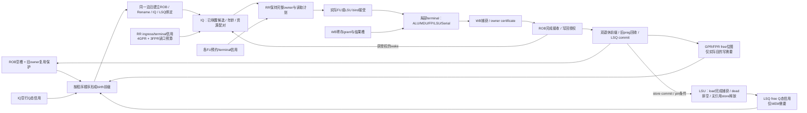
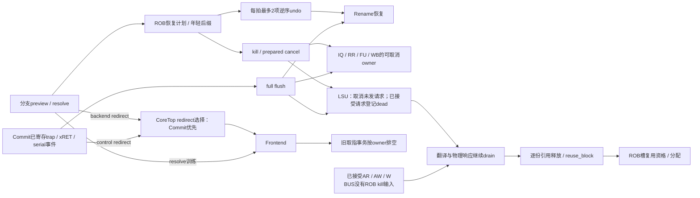
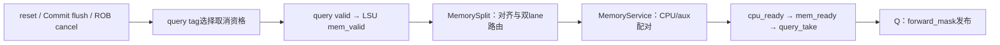

# 承岳64全核拓扑与可量化设计边界

范围为实际 R64CoreTop 与包含 Fabric/设备的 R64SystemTop。结构以当前 RTL 的实例化和参数为准；下面标有 2026-09 的实验说明保留历史含义，不是当前优化计划。不能把文件列表等同于实际实例：通用参考 helper 和可选 Tensor 数据通路需与生产 elaboration 区分。


## 2026-10-11 当前依赖与访存延迟优化

生产实现保留各域Recovery、Effect租约、完整tag认证和原子birth协议。
执行域新增Issue promised Q与RR六个holder的pending/value Q，普通ALU依赖执行间隔定向为2拍；
promise只改变调度资格。ALU宽值由驻留Q身份选择，当前认证只控制可用性；WB先进入RR本地值Q。
当前关闭Execute的当拍接受唤醒，仅用issue promise提前调度，保留已登记token及head事件；
RR独立捕获四路原始数据、preg和已认证valid；新owner只登记原pending，
下一边沿的既有首次read用本地source Q匹配同龄history Q，随后转移或本地保存。
v5映射STA确认这两处已切断重复授权→提前唤醒，以及当前IQ选择→ingress宽数据D的组合链，
但剩余当前ALU认证→RR有效→Execute共享仲裁→LSQ状态的最长路径达到-2.181022644ns。
当前保留v6引入的两类RR输出：登记数值就绪与本地ALU就绪；前者单独控制共享资源的live、priority和fire，
后者只控制ALU/分支接受。两者的接受结果仅在RR本地消费处合并，不反向借用terminal容量。
带pending整数源的非ALU需先在RR捕获真实值，再于下一边沿接受；已登记数据不增加等待。
MDU/FP head因pending Q等待时，已有受限escape可让后排ALU先执行；MEM/Serial/分支head仍不参与绕行。
详细状态和接口见[执行域协议](PROTOCOLS.md#4-执行域协议)与[后端拓扑](backend/TOPOLOGY.md#5-操作数与提前唤醒网络)。

Memory保留Bare结果捕获、prepared store准备与真实接受分离、真实B后store完成/退休重叠，
以及物理响应捕获后的下一边沿进入CQ。LSQ每次reservation清空forward_mask，
防止查询预写后取消、同槽重用为直发store时继承旧owner有效性。
bind仍先登记canonical LSQ，再由NEW状态进入翻译队列；同拍热绑定方案已撤下。
该实验在相同1ns SDC下产生RR→Execute→LSU→translation Q最差路径，WNS为-2.044941425ns，
不能作为当前保留架构的时序结论。

当前完整源码为v7，结果目录为[本批验证](../build/dual-utilization-20261011/alu-experiment/v7-validation/)。
v6同约束STA将setup WNS改善到-1.958410859ns，剩余最长链为ROB排序认证→IQ选择→current preg匹配→ingress resolved D，
仍差于基线-1.883478284ns。v7因此移除入口组合匹配，在既有首次read边沿用登记history解决同一个到达事件；
删除selector/fresh的12bit，新增preg/valid的28bit，净增16bit，无新增流水拍。
v7完整模块150+1、53配置、17负向、10域合同、8严格域lint均首轮通过；
Core/System/Platform严格lint 3项、Core 10例、System 10例、IO 4例、block 6例全部通过。
352例软件（AM 74、official 177、ACT4 101）、完整CoreMark 10次迭代及全部CRC、
Dhrystone 10000次运行、L2全部17阶段均由v7独立构建后自然完成；真实DiffTest与断言保留。
L2为分层mini-system验证，6063076条提交、486次trap、1次syscon正常关机；Tensor/NPU与L3不在本轮范围内。

| 完整工作量 | 本轮起点attempt3周期 | 当前v7周期 | 周期减少 |
| --- | ---: | ---: | ---: |
| CoreMark 10 iterations | 9552222 | 8653974 | 9.40% |
| Dhrystone 10000 runs | 15095119 | 12745924 | 15.56% |
| L2 all | 13973857 | 12073761 | 13.60% |
| 352软件合计 | 5306220 | 5079526 | 4.27% |

CoreMark当前提交3218537条（基线3218524条），CPI从2.967889降为2.688791；
计时/得分输出会使提交数变化，比较的是同一镜像的完整固定迭代及CRC，不能称指令流逐条相同。
Dhrystone两版均提交4260670条，CPI从3.542898降为2.991530。
352软件中仍有21例比attempt3略慢，最大为load-store的3.63%；合计包含CLINT定时等待，不是纯计算性能。
v7与v6的352例软件、30例短集成、两个长基准的全部profile计数及L2主要结果逐项一致，
证明本次history重排没有在这些完整工作量上增加周期；这不是形式等价证明。
7个持续双退休窗口仍各为768条/384周期，理想独立热循环CPI 0.5不代表通用负载。

完整CoreMark的IQ→RR零发射/双发射周期占比分别为69.19%/11.54%，
Dhrystone为74.43%/11.01%；“大部分时间满载双发射”尚未达到。
CoreMark约53.80%的总周期属于IQ非空但操作数或调度资格未满足，13.13%属于IQ空，
2.26%属于已有共同资格候选却未发射；资格包括promise，不等于数值已到或执行单元可接受。
该统计是IQ→RR接受宽度，不能替代FU实际执行宽度或退休IPC。
Dhrystone的STORE占raw unfinished-head样本71.42%，分母不是全部周期；
它与其它等待计数重叠，不能把该比例直接当作可消除的总线延迟。

v7同源真实标准单元综合已自然完成，三项mapped check均为0 problems；162条唯一警告主要为memory lowering，
另有原有R64Translation两处continuous-assignment-to-reg警告。原SDC、R64CoreTop、
icsprout55 TT 1.2V/25C和1ns约束保持一致，**1ns STA仍为FAIL**。

| 布局前PPA/时序 | 起点attempt3 | 当前v7 |
| --- | ---: | ---: |
| Global setup WNS / ns | -1.883478284 | -1.835898995 |
| Reg-to-reg setup WNS / ns | -1.815520763 | -1.835898995 |
| Setup TNS / ns | -121157.687500 | -128237.039063 |
| Hold WNS / ns | -0.036660694 | -0.036660694 |
| Hold TNS / ns | -5.241827965 | -5.242919445 |
| ICG setup WNS / ns | -1.826545954 | -1.754595876 |
| Cell area / um² | 3113953.919995 | 3141092.919995 |
| Edge-triggered registers | 252512 | 253834 |
| Mapped cells | 1033199 | 1049401 |

全局最差setup改善0.047579289ns，但寄存器间最差退步0.020378232ns，setup TNS也变差；
面积增加0.87153%。这是一项完整工作量周期与物理代价的取舍，不能称全面PPA改善或1GHz闭合。
与v6相比，v7计数完全相同，DFF实际净增16，global WNS改善0.122511864ns。

同一真实网表上的精确查询确认：
36个当前IQ源preg pin到4个ingress resolved D、28个arrival metadata D、256个arrival history D及256个ingress宽值D均NoPaths，
各端点集合非空；原v6 current-preg→resolved路径有-1.958410859ns的实际阳性对照。
登记metadata Q到resolved D仍有真实本地路径，slack +0.123488948ns；到late_data D为+0.019090120ns。
两路当前认证源经MEM、MUL、DIV、CLMUL、FP、Serial的实际fire到相应状态D均NoPaths，
各实际fire和目标集合非空；当前认证经local ALU valid到ALU状态的功能通路仍存在。
当前认证到RR本地late-data捕获仍有-0.921653807ns的路径，metadata输入最差为-0.661129475ns；
本次断链结论只覆盖上述精确边界，不表示RR所有局部控制路径都已闭合。
已经删除的selector/fresh端点为空，单独记录为结构已删除，不把空集合当作断链证明。

当前全局最长链为LSU forward_query_head_q[0]→prepared/forward选择→PhysicalMemory/MemoryService hint和cache请求选择
→Dcache接受/读控制→tagrd1_q[1][9]，仍是跨模块组合链。RR断链不等于全核没有长路径。
最差hold从外部rid_i[0]到AXI read client Q，未通过的原始检查及负slack均保留。
完整结果见[本版验证汇总](../build/dual-utilization-20261011/alu-experiment/v7-validation/validation-summary.json)、
[同源EDA和精确路径](../build/dual-utilization-20261011/alu-experiment/synthesis-v7/validation-summary.json)及
[剩余瓶颈分析](../build/dual-utilization-20261011/alu-experiment/remaining-bottlenecks.json)。
后文attempt3表格保留其历史含义；以上结果均为布局前测量，不替代物理签核。

普通cached load仍不产生ALU issue promise。源码推导的无背压返回路径如下；
假设消费者已在IQ等待该load、CQ/两路WB调度可接受该结果、无kill/flush及额外端口竞争。

| 边沿 | 真实接收/状态变化 |
| --- | --- |
| E0 | ResponseIngress捕获返回和完整身份 |
| E1 | CQ捕获；CQ请求预告使WB同边沿登记grant |
| E2 | WB捕获payload/accepted mask，ROB捕获owner certificate；随后组合产生写回授权 |
| E3 | PRF写入、ROB done和IQ ready登记 |
| E4 | IQ实际issue，RR ingress接受 |
| E5 | RR读/旁路采样后进入terminal |
| E6 | dependent ALU由Execute真正接受 |

E5之后组合可见的Execute候选不等于E5已接受。ResponseIngress到dependent Execute为上述理想条件下
6个周期的源码推导，不能冒充实测平均/最短延迟，也不包含此前地址/翻译/cache等待。
这条路径说明load-use仍有明显延迟，下一轮需量化结果交付与调度之间的等待，
不能把增加IQ容量或发射宽度等同于解决依赖问题。

论文和现有核心提供的设计经验在本轮用于确定边界，而非直接移植RTL：
[BOOMv2](https://www2.eecs.berkeley.edu/Pubs/TechRpts/2017/EECS-2017-157.html)和
[SonicBOOM](https://people.eecs.berkeley.edu/~krste/papers/SonicBOOM-CARRV2020.pdf)
支持同时评估依赖延迟、完整工作量IPC和真实时序；
[BOOM Issue Unit](https://docs.boom-core.org/en/latest/sections/issue-units.html)
将fast wake与对应bypass通路联系起来，本实现据此明确区分调度promise与真实数值；
[香山Store Queue](https://docs.xiangshan.cc/projects/design/en/kunminghu-v3/memblock/LSU/LSQ/StoreQueue/)
用于参考地址/数据准备与后续提交、物理排出的职责划分。
本核保留真实BRESP错误的精确异常合同，因此未照搬提交后再异步排出store的策略。

## 2026-10-10 RTL事务边界重构：本轮基线

当前以[协议 v2](PROTOCOLS.md)和实际源码为准。下文较早阶段的“同拍恢复、零新增流水”
及周期一致结果只描述此前实现。

| 边界 | 实际状态与代码 | 对跨域控制的约束 |
| --- | --- | --- |
| Recovery | 各服务拥有 R64RecoveryInbox；Backend 持有 recovery_fence_q | t0 撤架构资格，t1 本地清理，t0/t1 不创建新身份 |
| Memory Effect | Control.R64MemoryEffectLease | 带完整tag的不可撤销寄存许可；匹配head完成后释放，fault后允许trap |
| Memory Retire / reuse | Memory.local_retire / reuse_publication_q | 退休登记后本地释放；占用公告同边沿记 acquire，晚一拍释放 |
| 原子 reservation | Memory ranked FREE-Q offers；Backend 本地 lane/rank 映射 | 不再有 decode want→Memory ready→Backend birth 往返 |
| 分支事件 | ROB resolve_accept / redirect_accept | 完整身份与预备plan认证后才发布；迟到错路候选不产生全局副作用 |
| 提前供值 | Execution.R64ExecutionOwners | birth 建身份、认证WB/本地恢复终结；无生产 ROB fast-query 往返 |
| 物理响应 / 完成 | R64LsuResponseIngress → R64LsuCompletionArbiter → R64LsuCompletion | 捕获时登记payload/live；occupied Q选择payload，取消只控制窄发布 |

~~~mermaid
flowchart LR
  LIFE["Lifecycle: ROB / Rename / WB authority"] -->|"Recovery t0"| INBOX["各域 Recovery Inbox Q"]
  INBOX -->|"本地事件 t1"| OWN["本地指令 owner / 排空"]
  LIFE -->|"原子 birth + 完整 tag"| EXEC["Execution Owners / IQ / PRF / RR"]
  FREE["Memory FREE-Q ranked offers"] --> LIFE
  LIFE -->|"显式 slot reservation"| LSQ["LSQ / ordering / effect"]
  CTRL["Control precise head"] --> LEASE["Memory Effect Lease Q"]
  LEASE --> LSQ
  LSQ --> PHY["Translation / Physical Service"]
  PHY --> CAP["Response capture Q"]
  CAP --> CLASS["Classified occupied / live Q"]
  CLASS --> ARB["6源 payload 仲裁: occupied + RR Q"]
  ARB --> CQ["Completion固定槽"]
  CQ --> WB["寄存 WB / ROB认证"]
  OWN --> PUB["reuse publication Q + 同拍 acquire"]
  PUB --> LIFE
~~~

该基线的生产 RTL 网表已完成标准单元综合与 STA：R64CoreTop、icsprout55 TT 1.2 V / 25 C、1 ns，
三轮实际 SDC 内容相同。综合 PASS，三个 mapped checks 均为 0 problems；1 ns 时序仍为 FAIL。

| 指标 | 重构前 domain-validation | 最终 attempt3 |
| --- | ---: | ---: |
| Setup WNS / ns | -2.529361963 | -1.883478284 |
| Reg-to-reg setup WNS / ns | -2.240734100 | -1.815520763 |
| Hold WNS / ns | -0.036660694 | -0.036660694 |
| Setup TNS / ns | -139625.812500000 | -121157.687500000 |
| Cell area / um² | 3083538.359995 | 3113953.919995 |

非空集合查询确认：Commit event 的 1 个 Q，以及 Memory Recovery 的 34 个 Q，
到全部 596 个 CQ tag/result D 均无组合路径。最后收尾还删除了 AluLane 已登记候选出口的
重复 Recovery 资格检查；相同的 34 个 Execution Recovery Q → 4 个 raw branch pin →
1 个 accepted redirect pin 查询，attempt2 有路径，attempt3 无路径，正常 raw→accepted 路径仍存在。

剩余最差寄存器路径为 resolve_lane_q → 分支 tag 双lane选择 → ROB 完整身份/plan认证 →
accepted redirect → Decode clear/out_valid → 原子 birth → LSQ 预约 → older_q 年龄矩阵 D。
ROB、Rename、Execution owner 和 LSQ lease 仍在共同 birth 边沿接受同一事务；
这是保留的同步协议边界，各域通过该协议共同接受事务；原有时钟与路径约束保持不变。
全局 setup 最差仍由 rst_i 发起，经恢复资格和共同 birth 落到年龄矩阵。
具体节点、非空集合与阳性对照见[最终综合与时序报告](../build/rtl-domain-rebuild-20261010/attempt3/synthesis/analysis-notes.md)。
这些是布局前结果，不代表 1 GHz 或物理签核。

最终 attempt3 功能回归全部完成，执行模型均由最后版本重新编译；运行期间生产 RTL 未变化。

| 验证范围 | 最终结果 |
| --- | --- |
| 默认 CPU 模块 / 额外 sum_equal | 143/143 + 1/1 PASS |
| 配置矩阵 / 唯一负向断言场景 | 53/53 + 17/17 PASS |
| 独立域合同 / 严格域 lint | 10/10 + 8/8 PASS |
| Core / System / Platform 严格 lint | 3/3 PASS |
| Core / System NEMU 程序回归 | 10/10 + 10/10 PASS |
| I/O / block 程序回归 | 4/4 + 6/6 PASS |
| AM / official ISA / ACT4 | 74/74 + 177/177 + 101/101 PASS，无重试 |
| CoreMark / Dhrystone | 10 iterations / 10000 runs，自然 PASS |
| L2 all | 17 阶段完整，6063076 commits / 13973857 cycles / 486 traps / 1 syscon |

以上分类有交叉，不将它们相加成“唯一测试总数”。L2 指第二层 mini-system 验证，
包含 OpenSBI、M/S/U、Sv39/A-D/权限恢复、原子与 fence、timer、MMIO、PLIC/UART 和自然关机；
不是 L2 cache 或完整 Linux/Ubuntu 认证。全部 352 项软件与 2 项固定基准均为首跑自然 exit 0。
最终分支出口切片前后，352 项软件、30 项集成程序、两项基准及 L2 的已测计数一致；
这属于确定性工作负载观察结果，不是所有输入的形式等价证明。

| 固定工作量 | 重构前周期 | 最终周期 | 周期变化 | 重构前 CPI | 最终 CPI |
| --- | ---: | ---: | ---: | ---: | ---: |
| CoreMark 10 | 8968518 | 9552222 | +6.50837% | 2.7865200866 | 2.9678890075 |
| Dhrystone 10000 | 14267505 | 15095119 | +5.80069% | 3.3486529114 | 3.5428979480 |
| L2 all | 13265685 | 13973857 | +5.33837% | — | — |

CoreMark 固定迭代和全部 CRC 相同；含计时/输出的全程序提交数比重构前少 13 条，
不声称两者机器指令流完全相同。七个整核热窗口仍各为 768 条 / 384 拍，CPI 0.5。
新增周期主要表现为无退休等待：CoreMark 增加 573867 个无退休周期，
Dhrystone 增加 822617 个；其他 profile 指标互相重叠，不能相加作为独立原因占比。

本轮范围截至 L2 all，Tensor/NPU 和 L3 排除。最终结论为：功能 PASS、综合 PASS、1 ns STA FAIL。
[统一验证汇总](../build/rtl-domain-rebuild-20261010/attempt3/validation-summary.json)、
[软件与性能比较](../build/rtl-domain-rebuild-20261010/attempt3/software/comparison.json)
和[最终构建目录](../build/rtl-domain-rebuild-20261010/attempt3/)保存完整结果。
初次真实分支恢复失败与修复、早期参考库路径/重链接问题保留在各轮历史日志中，
没有删除断言、替换真实 RTL 或放宽 STA 约束。


## 2026-10-10 较早阶段：接口与状态所有权拆分

完整接口、事务生命周期和各团队开发入口以[公共协议](PROTOCOLS.md)为准；
较早日期/阶段的说明保留历史意义，该阶段的结构如下：

~~~text
CoreTop：只组合公开端口、上下文和恢复优先级
├─ Frontend：fetch record → Lifecycle
├─ Backend
│  ├─ Lifecycle：Decode / Rename map+free / ROB / WB authorization
│  └─ ExecutionDomain：Scoreboard / IQ / PRF+RR / Integer Execute
│      ├─ MEM command205 → Memory
│      ├─ FP command32 → FpExecute
│      └─ Serial command217 → Control
├─ Control：Serial / CSR / Commit
│   └─ Effect12、Retire20、flush/redirect、上下文
├─ Memory
│  ├─ DataTranslationService：opaque token账本 / DTLB+walk / Protection
│  ├─ PtePort × 3
│  └─ LoadStore
│      ├─ LSU：canonical instruction owner、排序、取消、转发
│      └─ PhysicalMemory：Split / Service / Dcache及store来源路由
└─ AXI read / write：独立外部事务owner
~~~

生产busy状态从Rename迁入Execution.Scoreboard，未保留生产副本；
翻译返回配对账本从LSU移入DataTranslationService，LSU以tr_issued保护token租约；
store终端source解释归物理服务。CoreTop不再窥探ROB/Execution私有状态进行授权检查。
Fetch35/Dispatch218是公开静态ABI；下游服务只消费原生命令。
恢复仍是精确同边沿广播，外部已接受事务必须排空；没有增加通用NoC或额外流水拍。

独立编译清单见[domain-filelist.mk](domain-filelist.mk)，测试入口见
[domain-tests.mk](../testbench/chengyue64/domain-tests.mk)。
该阶段已运行：

- 八个域分别采用整核严格lint设置独立elaborate，通过；源码集合不包含无关peer域。
- 六项独立合同测试通过：Execution、Control、TranslationService、FP、Frontend、LSU network。
  Execution测试不实例化ROB/Rename/Backend；Control测试45项公开端口断言；
  Translation测试48个9-bit token，含满队列、44拍背压、双lane、取消排空和在途SFENCE。
- Backend、Rename/Scoreboard冻结参考、head Serial、前端、FP、Commit、
  LSU/真实cache、Service/翻译及取消/来源错误负向检查通过；完整矩阵结果在本次build目录。
- 五程序×plain/stalls的整核NEMU DiffTest全部通过。与较早控制链解耦完成后的基线比较，
  10,718条退休/trap事件的内容、顺序和发生周期完全一致。
- 整核七个热窗口各768条/384拍，CPI=0.5；本次没有综合、STA、PPA或完整OS验证。

证据：[独立域](../build/domain-decouple-20261010/domain-run.log)、
[系统回归](../build/domain-decouple-20261010/system-final.log)、
[逐事件比较](../build/domain-decouple-20261010/trace-comparison.json)、
[吞吐](../build/domain-decouple-20261010/system/throughput/result.json)。
本次结构变化未更新正式release/PPA结论。

## 2026-10-10 较早阶段：模块间控制链解耦

本次针对三个真实控制依赖收敛模块边界。接口仍使用Verilog端口和现有事务身份，
不增加全核统一stall或延迟恢复广播。

| 边界 | 解耦后的契约 | 被消除的组合依赖 |
| --- | --- | --- |
| Backend/ROB → Control/Commit | ROB发布本地完成候选；Commit独立接受有序前缀，Serial独占、异常禁止退休 | Commit ready/第二路许可 → ROB lane1 valid → Commit退休 |
| LSU completion → Writeback | 每lane两个固定payload槽；取消/消费更新valid与head，payload只写Q态空槽 | WB ready/flush/kill → front/back宽payload搬移 |
| Cache → AXI read | 两项AR描述符队列以Q占用提供信用；已接受请求保存至AR发送，client owner保持至末响应交付 | 外部ARREADY → 内部cmd_ready → Cache命令接受 |

Decode、RegRead、FP和AXI write已有的本地信用继续保留。ROB/Rename/IQ/LSQ的原子birth、
ROB的完整tag完成授权、精确恢复广播、LSU/Serial的reuse_block、head副作用许可、
Memory drain_idle与CSR退休上下文是必要的正确性联系，仍有明确端口。
LSU六源完成仲裁仍会检查当拍取消，本轮只切断完成存储中的宽payload搬移；
因此本轮不声称所有全核组合链均已断开。

本轮验证（2026-10-10）：

- 整核严格Verilator lint通过，生产assertion保持启用。
- 21项不同模块测试通过，另通过pipeline的7种工作负载/停顿组合、LSU network的4种组合、
  response-bypass 0/1 × plain/stalls。退休测试明确检查背压下仍发布双候选；
  legacy reference保留旧许可投影，比较旧协议投影及实际退休前缀。
- Completion冻结参考逐拍比较20,000拍，覆盖11555次接受、11352次返回；
  新增有效物理槽在取消/消费边沿payload不变检查。AXI通过512事务/2304 beat，
  以及bad-id/bad-last/bad-count/early-r四种预期失败。
- 从修改前RTL独立构建SystemTestTop基线；同镜像、NEMU参考、单宿主线程与确定性停顿下，
  修改后5程序 × plain/stalls全部DiffTest通过，10718条退休/trap事件的内容、顺序和
  **发生周期**逐行一致。两侧总周期、双退休、读写及trap计数一致。
- 修改后完整吞吐程序DiffTest通过，7个热窗口各768条/384拍，CPI=0.5。

| 程序 | plain周期（修改前=后） | stalls周期（修改前=后） |
| --- | ---: | ---: |
| program | 1074 | 1133 |
| sv39 | 993 | 1079 |
| sdtrig | 4075 | 4207 |
| lsu_contention | 29426 | 36006 |
| backend_network | 4354 | 4439 |

证据：[整核运行](../build/control-decouple-20261010/candidate-system-run.log)、
[事件比较](../build/control-decouple-20261010/trace-comparison.json)、
[吞吐](../build/control-decouple-20261010/candidate-system/throughput/result.json)、
[集成模块](../build/control-decouple-20261010/integration-modules.log)。
原始含周期事件在同目录的baseline-trace/candidate-trace中。
这些是已运行定向范围的结论；本次未运行完整软件/OS回归、综合、STA或PPA。
两个CQ head selector和AR描述符容量变化的物理成本尚未测量。

## 2026-10-09 全核职责重审与等行为重构

本轮目标是让每个模块围绕完整职责和事务生命周期组织，减少不必要的内部协议外泄。
容量、仲裁、寄存边沿、取消优先级和外部 ABI 保持原设计；文件变短不单独作为验收依据。

| 域 | 源码重审结论 | 本轮处理与保留边界 |
| --- | --- | --- |
| CoreTop / Control | 顶层直接中转 CSR 查询/准备/退休、IRQ 判定及原始 PMP，了解过多控制域细节 | 新增 [R64Control](control/R64Control.v)，内部保留 Serial、CSR、Commit 三个状态 owner 和组合 PMP 译码；对外只保留执行、退休、恢复、上下文、失效与 Tensor 合同 |
| Frontend | 取指访问 holder/翻译/Cache 与预测、对齐及指令 FIFO 同属一个实现体 | 新增 [R64FetchAccess](frontend/R64FetchAccess.v)，收拢请求上下文、poison、翻译与 ICache；Frontend 通过顺序 req/rsp 服务连接，继续拥有流调度和预测入队 |
| Backend | birth、完成授权、恢复及 ready/bypass 依赖多，但对应共同指令身份 | 保留 ROB/Rename/IQ/LSQ 同边沿原子 birth，以及 ROB 对 WB/early wake 的权威授权；不为十几行组合逻辑添加 Admission/Wakeup 转接壳 |
| FP | 数值单元和本地完成 owner 边界合理，入口却接收整条后端 UOP | [FpExecute](fp/R64FpExecute.v) 改为 command32；调用者从 UOP 投影。FMA/Fast/Long、动态 rounding、完成和取消周期保持 |
| LSU | canonical row/年龄/effect/pin 应协同持有；翻译返回账本可独立 | 新增 [R64LsuTranslationOwners历史oracle](../testbench/chengyue64/oracles/R64LsuTranslationOwners.v)，封闭两路各4项已接受翻译的 slot/protection、指针、计数和信用；canonical LSQ 仍由 LSU 持有 |
| 翻译/保护 | Memory/LoadStore 主要负责装配；ITLB/DTLB/PTE 的 owner 已各自明确 | 保留双数据翻译、三 PTE 端口、共享 PMP 事实和权限检查；ProtectionPrepare 仍在 CoreTop，使用同一翻译结果的 PA/privilege |
| DCache / 物理服务 | refill、store-B、pending write、LR/SC 与物理 bank 强相关 | 保留 Split/Service/DCache 边界和普通 store 专用终端；不导出整张 LSQ 数组来拆物理响应逻辑 |
| AXI / 平台 | ID、beat、Fabric slot 和设备副作用各有 owner，与 ROB kill 解耦正确 | 保留原模块；已接受 AR/AW/W 必须排空，平台地址图和可选 Tensor GMEM 接口不变 |

新的实际子树：

```text
R64CoreTop
├─ frontend : R64Frontend
│  └─ access : R64FetchAccess
│     ├─ u_translation : R64FetchTranslation
│     └─ u_cache : R64ICache
├─ backend : R64Backend
│  └─ Decode / Rename / ROB / Issue / RegRead / Execute / Writeback
├─ fp : R64FpExecute                 ← command32 / tag / operands
├─ control : R64Control
│  ├─ serial : R64Serial
│  ├─ csr : R64Csr
│  ├─ commit : R64Commit
│  └─ pmp_decode : R64PmpDecode
├─ memory : R64Memory
│  └─ unit : R64LoadStore
│     ├─ lsu : R64Lsu
│     │  └─ translation_owners : R64LsuTranslationOwners
│     └─ split / service / cache
└─ read_bus / write_bus
```

可量化的结构结果：

- Control 隐藏26个 CSR/return/退休反馈/IRQ准备/原始 PMP 私有命名网络；trap/trace 格式化也归入控制域。
  Serial、CSR、Commit 的原状态 owner 没有合并或复制，Control 自身没有新增寄存器。
- FetchAccess 收拢原有136-bit请求 payload与valid/poison共138 bit直接状态，Translation/ICache 子实例随其归属迁移。
  空 holder 仍直通，阻塞时才保存；不向 Access 增加 run 冻结条件。
- TranslationOwners 收拢原有8项 slot/protection 加两路指针/计数，生产 INDEX_W=5 时共86 bit。
  信用仍只来自当前 count，满队列不能借同拍 pop 接新请求；无 flush/kill 清空接口。
- FP command 输入由218 bit缩至32 bit，去掉186 bit无关 UOP 字段；这衡量协议依赖，并不代表节省186个物理单元。

必要的耦合保持显式：`birth` 同时建立 ROB/Rename/IQ/LSQ，`full_flush` 不能代替选择性 kill，
`reuse_block` 不能由完成 valid 推导；CSR/失效副作用仍等同 tag 真实退休，
已接受的翻译、PTE、AXI 和 Tensor 事务继续排空。Serial 的 memory_idle 仍接 Memory.drain_idle，
不接仅表示 LSQ owner 为空的 idle。

后续可独立评估的职责边界包括：Issue+RegRead/PRF 的完整操作数分派域；Frontend 的
Bundle→Token→Result→admission；LSU 已选元组后的完成仲裁/格式化域。
这些是进一步维护性的候选，不是本轮已经完成的拆分。物理响应若直接导出20项 LSQ metadata 会增加耦合，
因此保留 canonical row、转发 pin 和精确 effect 共同归属。

### 本轮验证结果

- `make -C npc/rv64 lint` 和 `make -C npc/rv64/sim tensor-lint` 通过，保留全部生产断言和既有真实 lint 诊断。
- 27项累计定向测试通过，覆盖 Frontend ingress/恢复/保护、7项 FP、LSU reserve/bind/返回/进展，以及 CSR/Serial/Commit/trap。
  [测试清单](../build/cohesion-20261009/module-summary.txt)和[执行日志](../build/cohesion-20261009/modules.log)保存了本次范围。
- LSU 独立补充的 owner-bypass 与 descriptor-payload 两项通过，覆盖别名/部分转发/LR/AMO/IO/A-D/kill/满队列/双响应。
- 从修改前源码独立构建 SystemTestTop 基线，与本轮 SystemTestTop 在相同镜像、参考库、单宿主线程和确定性停顿条件下比较。
  6个程序×plain/stalls，共12组、24次执行，均通过 NEMU GPR/FPR/CSR 差分；
  每条退休和 trap 的内容、顺序、发生周期逐行相同，最终周期/双退/读写计数也相同。
- 静态复核确认 Control 的152个子模块命名连接及19个trace/trap赋值保持原映射，CoreTop公开参数/端口不变。
  新模块进入生产filelist，仿真CSR快照和CPI观察跟随实际层级；`git diff --check`通过。

| 程序 | 退休指令数（两模式相同） | plain 周期（A=B） | stalls 周期（A=B） | 逐事件轨迹 |
| --- | ---: | ---: | ---: | --- |
| program | 125 | 1074 | 1133 | 一致 |
| sv39 | 56 | 993 | 1079 | 一致 |
| sdtrig | 302 | 4075 | 4207 | 一致 |
| lsu_contention | 4133 | 29426 | 36006 | 一致 |
| backend_network | 722 | 4354 | 4439 | 一致 |
| throughput | 8232 | 5736 | 7068 | 一致 |

A/B 原始结果见[执行摘要](../build/cohesion-20261009/ab.log)与[逐组数据](../build/cohesion-20261009/ab/summary.json)；
构建产物在 `build/cohesion-20261009/{baseline-system,candidate-system}`。
这些是本轮已运行程序的行为与周期证据，不是穷尽等价证明。
本轮未运行完整软件回归、Linux/Ubuntu、Tensor动态系统验证或新的综合/STA/PPA，历史性能表仍保持原测量范围。


## 2026-10-09 源码核对与读图规则

当前源码保留第一轮普通 RAM load response bypass 基线 B；第二轮取消前仲裁 + 固定物理 CQ、
第三轮同拍取消发布 + CQ 确值旁路的联合候选均已撤回。截至2026-10-09，CQ为front/skid两lane、总四条；2026-10-10改为每lane两个固定payload槽、容量仍四条，
当前不存在第三轮的 CQ → IQ/RR 确值旁路。源码连接核对入口为
[CoreTop](core/R64CoreTop.v) 与 [Backend](backend/R64Backend.v)，后端内部职责、接收边沿和完成授权见
[Backend 拓扑](backend/TOPOLOGY.md)。其它域也已按同一方式整理生产配置、文件职责、实例层级、
接收/取消边界及验证入口，见[RTL 目录导航](README.md)；可选 Tensor 的独立 GMEM 接入见
[平台说明](platform/README.md)。

候选裁决分别见 [第二轮结果](../ai/tests/2026-10-08-round2-architecture/RESULT.md)、
[第三轮结果](../ai/tests/2026-10-08-round3-cq-value/RESULT.md)；
下表保留 2026-10-08 基线 B 的既有测量，路径诊断见
[输入/输出及 Q 起点 STA](../results/ai-cq-timing-20261008/PHYSICAL-COMPARISON.md)。

| 2026-10-08 保留基线 B 的既有测量 | 数值 / 限定 |
|---|---|
| CoreMark 10 完整执行 | 8,968,518 cycles / 3,218,537 retired；CPI 2.786520087 |
| Dhrystone 10000 完整执行 | 14,267,505 / 4,260,670；CPI 3.348652911 |
| 布局前完整 SystemTop STA | icsprout55 TT/1.2V/25C；1 ns；uncertainty 0.05 ns；setup WNS −2.119304419 ns；hold WNS −0.036660694 ns；FAIL |
| 最差输入路径 | rst_i → Commit full_flush → ROB kill_mask[18] → LSU event_select → event_before_q[0] |
| 已有内部 Q 起点违例 | Commit event_trap_q → CQ payload：−1.892150521 ns；→ raw response control：−1.749530077 ns |
| 相邻限制 | effect_q[1] slack −2.109362364 ns；CQ payload 最差 −2.111715555 ns；不能只追一个端点 |
| 正常合资格 load 的已测完成延迟 | load_chain 的真实 response → CQ 捕获 0 拍，response → WB 接受 2 拍；不是完整 load-to-use 延迟 |

表中数据来自既有冻结 RTL 测量，本次拓扑更新没有运行新基准或 STA。旧结果与当前结构说明分开阅读。

全核优化的设计单元以“状态由谁持有、在哪个边沿接收、接收前后允许做什么”为边界，不以一个 Verilog 文件为单位。
各域当前表使用 FE / BE / FP / CTL / MEM / LSU / BUS 稳定 ID。它们是定位和测量的坐标，允许网页设计者
提出合并、拆分、重定时、预测或信用变更；不是限制架构搜索只能在单模块内进行。
[设计单元与输出约定](../ai/topology-contract.md) 定义需要记录的可量化属性及 UNKNOWN 表达。

- **数据网络**：值和完整 tag/owner 从哪里来，何时可被使用。
- **资格/信用网络**：valid/ready/grant/credit 是旧 Q 态、本拍组合还是已登记预约；图中一条箭头不自动等于一拍。
- **取消/恢复网络**：reset、全清、选择性 kill、undo 与 owner 复用是不同条件。
- **副作用网络**：store/CSR/AXI 在哪个真实接收边沿不可撤销；晚到响应由哪个状态排空。

reset 是同步状态清除，并用于组合接口静默。运行时 full_flush 为
`!rst_i && event_valid_q && (!event_trap_q || event_prepared_q)`；普通分支另走选择性恢复。
reset 出现在 STA 起点不证明所有路径是假路径，也不证明复位初值要经过仲裁才能产生。
2026-10-10的CQ宽payload只在Q态空槽预写，reset/flush/kill/ready更新有效性与head，不再控制宽数据搬移；事件仲裁的取消检查仍保留。



请求、返回、信用与取消是四张相互约束的网络。图中实线为主要请求/结果，虚线为提前唤醒、恢复、上下文与事件。ROB tag、LSQ slot/token、Fabric事务槽和 AXI ID 属于不同命名空间；只在明确接收边沿建立对应关系。

Backend 边界内包含 DecodeStage、Rename、ROB、IQ、RegRead/PRF、Execute 和 Writeback；
FP 与 Control 是 CoreTop 的同级域；Serial、Commit、CSR 与 PMP 译码封闭在 `CoreTop.control`。
LSU 位于 `CoreTop.memory.unit.lsu`，翻译返回归属由其 `translation_owners` 子模块持有；
I translation / ICache 位于 `Frontend.access` 内。数据翻译与保护先返回 LSU，再由 LSU 发物理请求至 Split/Service，
不能把 Translation 画成直接驱动 DCache 的流水级。图中的“写回发布”和“short-owner 查询授权”
是接口逻辑视图，不是额外流水级或模块。WB 提供结果数据，ROB 授权后才更新 PRF、Rename ready 和 IQ；
ALU 的 early wake / bypass 也先通过 ROB 的完整身份与目的寄存器检查，不设置 ROB done；
旁路的 64-bit 结果由 Execute 保持并送往 RegRead，ROB 只提供授权。

分支 redirect 源于 Execute，经 Backend 输出至 CoreTop；ROB 消费同一分支事实，负责取消与逆序 undo。
CoreTop 对前端的 redirect target 选择为 Commit 优先，再取 Backend；分支 resolve 另用于前端预测器训练。
LSQ reserve 发生在 birth，后续 Execute MEM bind 只补齐已有 slot/tag 的操作数，不再分配新的访存 owner。

## 2026-09 全拓扑迭代历史记录

下表与紧随其后的基线数字属于 2026-09 迭代；保留可复核出处，不作为本轮首选方案。

| 模块域 | 详细拓扑 | 当时处理与判据 |
|---|---|---|
| 前端 | [Frontend](frontend/TOPOLOGY.md) | 空槽准备、部分消费指针、RAS并行转发；先要求相同 CPI/恢复计数。 |
| 后端 | [Backend](backend/TOPOLOGY.md) | 双空项前缀、IQ空行数据准备、静态年龄矩阵；IQ32 单独试验。 |
| 整数/浮点执行 | [Arithmetic/FP](fp/TOPOLOGY.md) | 保持拍数的公共 carry finish；FP四源选择与数据捕获。 |
| 提交控制 | [Control](control/TOPOLOGY.md) | 保留精确事件边界和现有 CSR 快路径；基准未显示扩大串行快路径的收益依据。 |
| 翻译/保护/缓存 | [Memory](memory/TOPOLOGY.md) | TLB空项、PTE空闲数据、ICache查询准备；最终按STA优化DCache物理写口。 |
| LSU | [LSU](lsu/TOPOLOGY.md) | 保留 pin/排空契约；STA反馈轮将宽转发数据提前至驻留query阶段准备，并移除物理发出时的重复 MEMORY 状态写入。 |
| BUS/平台 | [BUS](bus/TOPOLOGY.md) | 保留四批结构；与Core一同综合，确认全核路径而非只测孤立Fabric。 |

2026-09 基线事实：CoreMark 9,573,233 cycles / 3,218,524 retired，CPI 2.974417155；Dhrystone 15,259,347 / 4,260,670，CPI 3.581443059。26项观察计数有重叠，不能直接求和为总停顿。

完整 SystemTop 基线在1ns/0.05ns uncertainty、icsprout55 TT1.2V25C下，setup=-2.803282499ns，hold=-0.036660694ns，真实状态为 FAIL。最差链已定位至 DCache bank 写数据；不是所有模块频率都由这一个数代表。后续所有结论以同源测量为准，不能把数据路径优化直接换算为已实现的硅后Fmax。

原全拓扑迭代计划路径为 `tmp/rv64-whole-topology-20260908/PLAN.md`，原临时报告现不在工作区。
当时每阶段记录源码差异、配置、功能/CPI结果、STA路径与RTL对应，再清除综合网表及可再生构建产物；
此处保留历史数字与路径，不表示本次重新获取了原报告。

## 分配、执行与完成信用的完整连接

下图是主数据流之外的资源网络。箭头表示资格或可用空间的传递，不代表组合穿透，也不能把队列深度相加作为独立指令容量。



birth受阻的IQ、ROB、PRF、LSQ观察计数可能同时为真；它们不能相加成为总停顿。IQ变大可能只让指令更早进入ROB，从而把信用压力移到ROB。完成也有两层选择：FP/LSU先在本地形成结果，再参与全核9选2。局部结果已算完，不等于已唤醒消费者或可退休。

## 恢复和不可取消事务的连接



ROB tag、LSQ slot、Service source/token、AXI ID与Fabric事务槽属于不同标识空间。取消指令可以撤销其结果发布资格，但不能把已经接受的外部事务当作未发生，也不能在旧引用释放前复用其身份。

整合版DCache的pending write属于已接受的缓存更新，不是新发出的一条CPU指令或新的外部store。满足驻留命中且未poison/invalidate条件的成功B，以及可分配refill的真实R，产生缓存逻辑写事件；待写状态按byte向lookup转发，下一拍落阵列。它不受ROB分支kill撤销；invalidate清除tag valid，迟到的阵列写不能重新安装valid。LSU源store在无引用后释放时，后续物理查询仍能观察到一致的缓存数据。

整机综合反馈按 DCache 高扇出写数据 → LSU query_take 控制宽转发快照 / 冗余状态更新推进。各轮测量保留在结果目录；对外请求发布、pin释放、已发owner及完成资格维持原拍数，详细边界见 LSU 图。

## 2026-09 迭代末次 STA 暴露的跨模块路径

DCache和LSU宽数据优化后，完整SystemTop最差setup=-2.261837959ns，端点为LSU forward_mask_q[19][6]。这条路径实际经过query取消资格、MemorySplit和MemoryService，再返回LSU。它是有效性与接收信用的组合往返，图中的末端寄存器承接路径，不代表组合环。



当时报告据此提出检查 mask/descriptor 的准备与可见性、以及 Split/Service 的寄存信用；这是历史建议，当前方案由新的完整事实和实测决定。不能为缩短路径撤销真实取消检查，或让尚未接收的请求提前成为已发owner。当时的完整结果、IQ16/32取舍及后续验证问题曾记录于 `tmp/rv64-whole-topology-20260908/REPORT.md`；原临时报告现不在工作区。
