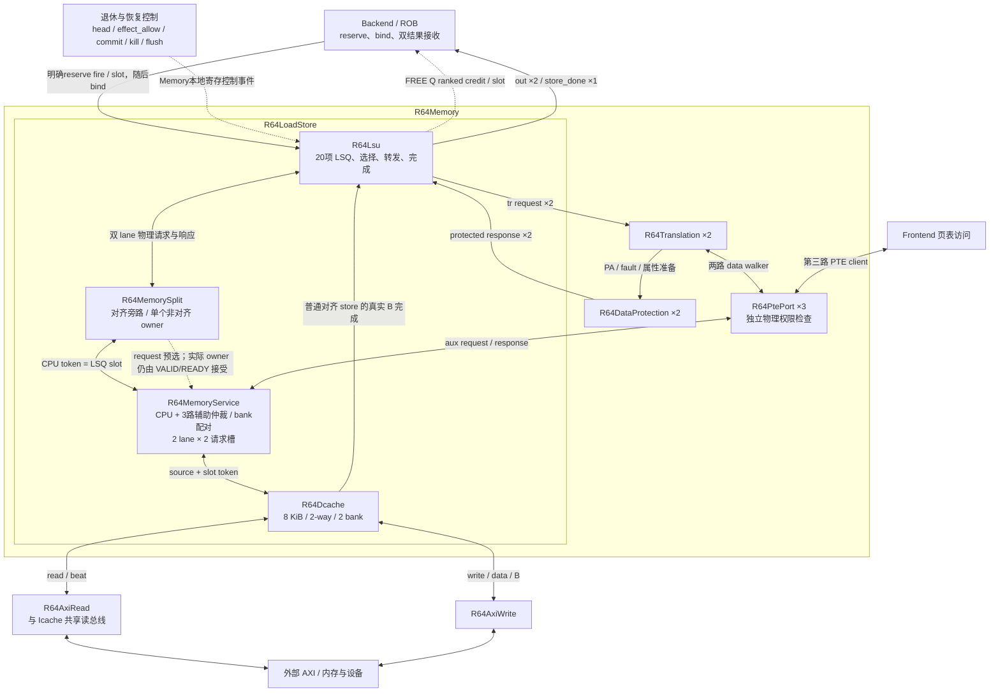
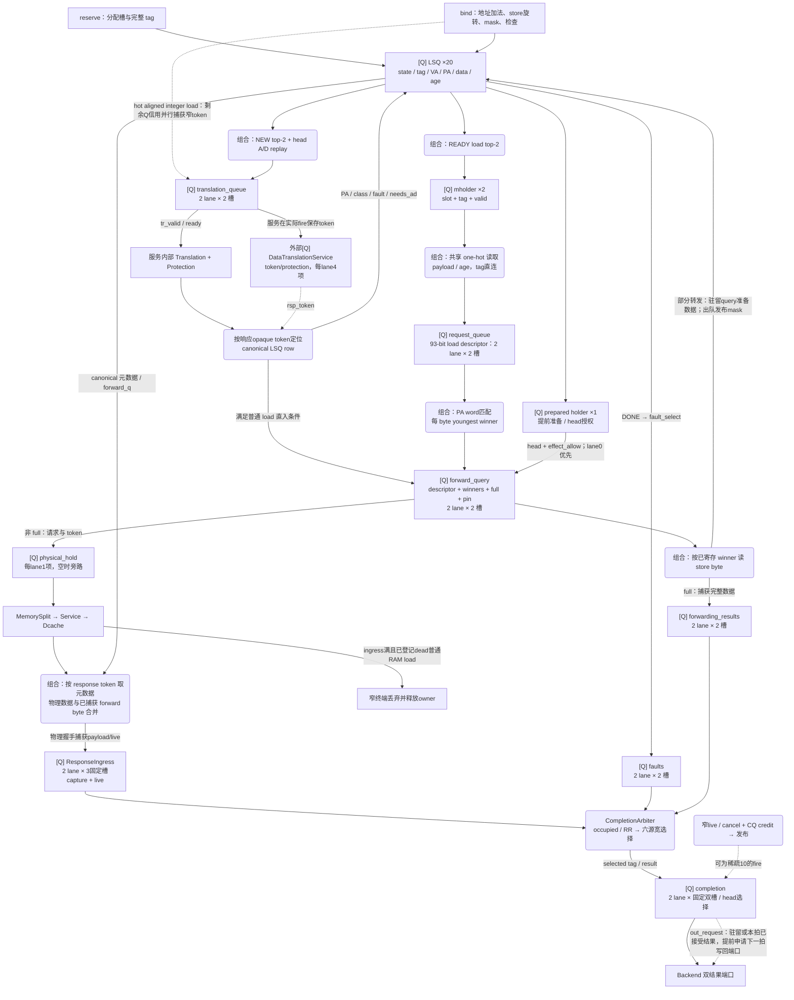
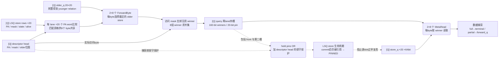
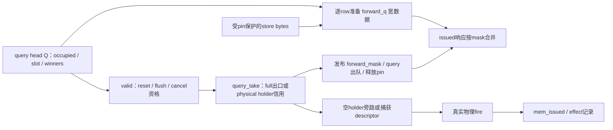
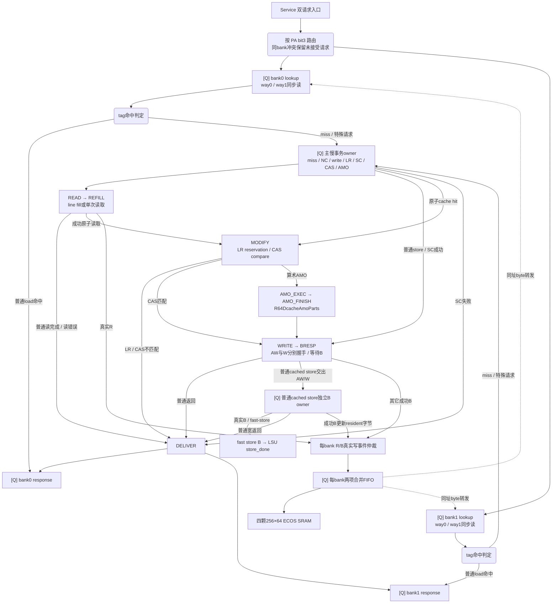

# 当前 LSU 拓扑网络

依据 **2026-10-10 工作区生产 RTL** 核对，入口为
`R64CoreTop.memory → R64Memory.unit → R64LoadStore`。
本文描述现有模块连接、寄存边界、真实接收与事务所有权，不把队列深度视为固定访问延迟。
[Memory 拓扑](../memory/TOPOLOGY.md)负责外部翻译/保护/PTE通道，
[Backend 拓扑](../backend/TOPOLOGY.md)负责原子分配、操作数绑定与完成接收。

当前响应链为R64LsuResponseIngress → R64LsuCompletionArbiter → R64LsuCompletion：
在物理握手边沿同时捕获完整tag/raw payload及live，下一边沿即可被完成队列接受。
incoming response bypass及RESPONSE_BYPASS参数已删除；registered occupied与RR Q决定宽选择，
当前取消只控制窄live发布。Completion双lane各两固定槽，支持稀疏第二输入。
2026-10-08旁路和CQ实验仅为文末历史，不代表本轮结构或周期/STA。

已接受翻译的token/protection账本已迁入独立R64DataTranslationService；LSU只持有canonical row及tr_issued_q，按返回token定位owner。旧账本保留在testbench/oracles，仅供历史协议测试。

**阅读图例。** [Q] 表示真实寄存状态；“组合”表示本级不保存事务；实线表示请求或数据流，
虚线表示控制、信用或引用保护；双向边表示请求及其响应。模块层次与数据流分别绘制，
避免将旁路误认成固定流水级。

## 1. 实际边界与生产参数

R64LoadStore组合LSU和独立R64PhysicalMemory端点；后者内部管理Split、Service与Dcache。
R64DataTranslationService拥有Translation、Protection与返回token账本，PtePort由Memory组合。
LSU持有指令/顺序身份；翻译与物理服务只回显opaque token，source编码由物理端点内部独占。

| 配置所在边界 | 当前取值 | 对拓扑的影响 |
| --- | --- | --- |
| Memory → LoadStore → LSU | `ENTRIES=20`、`INDEX_W=5`、`TAG_W=9`、`ROB_W=5` | 共享LSQ20项，5-bit slot、9-bit完整ROB tag；模块通用默认18项 |
| CoreTop → Memory → LSU | `HEAD_AUTHORIZED_QUERY=1`、`PREPARED_CANCEL=1` | head授权query及ROB候选/active取消投影；full flush仍独立生效 |
| LoadStore → LSU | `EARLY_STORE=1`（默认） | 普通store可在head前准备payload，真实副作用仍待head/effect_allow |
| LSU → ResponseIngress | 固定2 lane ×3槽，无bypass参数 | 捕获后下一边沿分类，最早两个边沿后由CQ捕获；取消不改宽选择 |
| Memory → LoadStore / Service | `AUX=3`、`SRC_W=2` | aux0为I walker、aux1/2为D walker；Service→Dcache token为source2+slot5 |
| PhysicalMemory → Service | `CPU_REQUEST_HINTS=1` | Split提供准确live请求预选；通用默认0；真实VALID/READY才建立owner |
| PhysicalMemory → Dcache | `CACHE_SET_W=6` | 64 set、2-way、2-bank、64 B line、8 KiB；SET_W沿用默认 |
| CoreTop → AXI适配器 | Read `CLIENTS=2`、Write `B_BYPASS=1` | I/D共享读口；真实B可沿窄store完成链返回，仍受终端信用控制 |

来源：[CoreTop](../core/R64CoreTop.v)、[Memory](../memory/R64Memory.v)、[LoadStore](R64LoadStore.v)、
[LSU](R64Lsu.v)、[Service](R64MemoryService.v)、[Dcache](R64Dcache.v)。

### 1.1 文件职责与当前使用方

| 文件 | 当前职责 / 实际使用方 |
| --- | --- |
| [R64LoadStore.v](R64LoadStore.v) | Memory.unit组合入口；连接LSU与PhysicalMemory客户端协议，汇总idle/drain，不解释cache source |
| [R64Lsu.v](R64Lsu.v) | unit.lsu；reservation/bind、canonical row、顺序、翻译发出事实/响应消费、转发/物理请求与完成仲裁 |
| [R64PhysicalMemory.v](R64PhysicalMemory.v) | unit.physical；拥有Split/Service/Dcache、内部请求提示、source routing和物理排空 |
| [R64LsuOrderSelect.v](R64LsuOrderSelect.v) | LSU内allocation/translation/load/fault/prepare五实例；CompletionArbiter内另有select_sources，按来源轮转而非ROB年龄 |
| [R64LsuMetaRead.v](R64LsuMetaRead.v) | LSU内多处one-hot payload/年龄/索引/字节读取；head special与A/D replay是唯一候选编码 |
| [R64LsuForwardByte.v](R64LsuForwardByte.v) | 每lane×8 byte，共16个；按older关系得到youngest store的one-hot winner |
| [R64LsuRequestQueue.v](R64LsuRequestQueue.v) | translation_queue、request_queue、forward_query、forwarding_results、faults五实例；Q信用、payload保持、tag和引用 |
| [R64LsuResponseIngress.v](R64LsuResponseIngress.v) | response_queue；双lane各三固定槽，captured/classified/live、完整tag与窄取消处置 |
| [R64LsuCompletionArbiter.v](R64LsuCompletionArbiter.v) | completion_arbiter；registered occupied与RR决定六源宽选择，live仅控制选中项发布 |
| [R64LsuCompletion.v](R64LsuCompletion.v) | 双lane各两固定槽，共四结果；支持稀疏第二输入、Q空位预写、head选择和WB需求 |
| [R64MemorySplit.v](R64MemorySplit.v) | unit.physical.split；对齐双lane旁路、非对齐单owner逐byte序列 |
| [R64MemoryService.v](R64MemoryService.v) | unit.physical.service；CPU/aux选择、异bank配对、请求队列、source返回路由与每aux独立busy/response |
| [R64Dcache.v](R64Dcache.v)、[R64DcacheAmoParts.v](R64DcacheAmoParts.v) | unit.physical.cache及arithmetic_parts；bank查找、单慢事务、独立普通store B owner、原子运算与ECOS55 SRAM adapter |
| [R64LsuSelect.v](R64LsuSelect.v)、[R64LsuYoungestByte.v](R64LsuYoungestByte.v) | 兼容/历史helper，仍在主filelist且有独立测试；当前R64Lsu未实例化，不能计入生产拓扑 |

## 2. 核心外围连接与物理访存拓扑



当前 aux0 是 Frontend 页表访问，aux1/aux2 是两个数据翻译通道的页表访问。
R64LoadStore 的通用默认 AUX=4 不代表当前核心接入4个辅助客户端；当前核心没有在该入口接入 Tensor。
PTE 辅助请求经各自 R64PtePort 检查后直接进入 Service，不占 CPU LSQ，也不经过 CPU 的 MemorySplit。

Service选中辅助读时，入口可以在CPU0/CPU1之间选择读配对：CPU0缺席，或CPU0与辅助读同bank、
CPU1位于异bank且两条CPU请求和辅助请求均为普通cached读时，选择CPU1；
否则保留CPU0路径。CPU0的特殊/NC请求与辅助CAS/写不因此被越过。
该选择位于请求槽捕获前；已有效的请求槽及下游保持的offer保持原token和payload。

LoadStore 显式启用 Service.CPU_REQUEST_HINTS=1，Split 另提供 request 预选信号，
让配对和空槽数据准备不必等待 pending-split 对实际 VALID 的门控。
只要任一 CPU lane 的实际 VALID 为1，两位 request 必须与两位 VALID 完全相同；
pending split 时实际两位 VALID 均为0，Split 的输入 ready 只接受慢路径 acquire，
因此预选 ready 不能创建 CPU owner。真实 enqueue、aux 选择、轮转更新和已占用槽的 owner 仍由原条件决定。
Service 通用参数默认0。这里的严格 live 输入契约不同于 WB 的端口需求提示：
WB 可以安全消耗空 grant，Service 的实际有效输入必须对应准确的 lane 配对。
RTL 断言逐拍对照原 CPU 接受式和实际捕获的 payload，正向及错误提示测试已加入默认回归。

翻译是 LSU 的外部服务，Dcache 是物理地址缓存。LSU 对每个已接受翻译保留canonical row与token租约；
页表读取/compare-and-OR 则通过同一物理 Dcache，形成带寄存状态的请求/响应依赖网络。

来源：[R64Memory.v](../memory/R64Memory.v)、[R64LoadStore.v](R64LoadStore.v)、
[R64MemoryService.v](R64MemoryService.v)。

## 3. 实际实例层级

```text
R64CoreTop
└─ memory : R64Memory
   ├─ translation : R64DataTranslationService
   │  └─ g_translation[0..1]：每lane4项token/protection账本
   │     ├─ translation : R64Translation
   │     │  └─ g_data.unit : R64DataTranslation
   │     │     ├─ u_tlb : R64Tlb
   │     │     └─ u_walk : R64PageWalk
   │     └─ protection  : R64DataProtection
   ├─ g_pte[0..2].port : R64PtePort
   └─ unit : R64LoadStore
      ├─ lsu : R64Lsu
      │  ├─ translation_queue : R64LsuRequestQueue
      │  ├─ request_queue     : R64LsuRequestQueue   ← descriptor
      │  ├─ forward_query     : R64LsuRequestQueue   ← 最终物理请求 / winner
      │  ├─ forwarding_results : R64LsuRequestQueue ← full-forward terminal
      │  ├─ response_queue    : R64LsuResponseIngress ← captured / live
      │  ├─ faults            : R64LsuRequestQueue
      │  ├─ completion        : R64LsuCompletion
      │  ├─ completion_arbiter : R64LsuCompletionArbiter
      │  │  └─ select_sources : R64LsuOrderSelect
      │  ├─ R64LsuOrderSelect ×5
      │  │  └─ allocation / translation / load / fault / prepare
      │  ├─ R64LsuForwardByte ×16                  ← 2 lane × 8 byte
      │  ├─ R64LsuMetaRead：多处 one-hot 元数据与字节读取
      │  └─ R64WideAdd ×2                          ← backend 目录的地址加法器
      └─ physical : R64PhysicalMemory
         ├─ split   : R64MemorySplit
         ├─ service : R64MemoryService
         └─ cache   : R64Dcache
            └─ arithmetic_parts : R64DcacheAmoParts
```

LSQ entry 阵列、older_q、mholder、prepared holder、physical_hold 与 store_done 是 R64Lsu 内部寄存逻辑；
已接受翻译的token FIFO位于外部DataTranslationService，full-forward结果由forwarding_results双槽队列保存。

目录里的 R64LsuSelect.v 和 R64LsuYoungestByte.v 仍列在主线 filelist，
但当前 R64Lsu 没有实例化它们。当前选择网络使用 R64LsuOrderSelect，
逐字节 youngest 判定使用 R64LsuForwardByte；不能由“文件在目录/filelist 中”
推断它是当前实例拓扑的一部分。

## 4. R64Lsu 内部请求和返回数据流



这张图的关键分流点：

- bind与翻译排队分属不同边沿：真实bind登记canonical LSQ地址/数据，普通合法load保持NEW。
  后续只从已登记的alive/bound/checked/NEW及A-D候选进入translation_queue，再转为TRANSLATING。
  实际翻译接受才建立tr_issued，取消不得提前复用。新reservation初始化forward_mask=0；
  无效宽快照可保留，prepared直发不能继承上一代owner的字节有效性。

- 翻译响应直入：成功普通对齐 load、非 IO、无需 A/D 重走，并且对当前 owner
  没有更老 barrier/ordering owner；还需对应 lane 的 query Q 信用及入口优先级允许。
  较老普通load的属性未知时仍为barrier，同拍成功RAM响应可解除这一未知属性屏障。
  不满足直入条件的正常响应保存在 LSQ，后续进入 READY 调度。
- prepared 入口：普通 store 可以在到 head 前准备完整 payload；head 特殊请求也使用
  prepared holder。选择 owner 的同一个边沿捕获 slot、tag 和完整 payload，省去原来的后续 payload 读取拍。
  payload 由原始 one-hot 并行读取；取消只决定是否接受这次准备，被取消的替换候选不能覆盖仍有效的旧描述符。
  只有 head/effect_allow 授权后才发出：普通对齐cached store在query/physical holder未占用时，
  直接以prepared Q作为物理候选；其他prepared请求保留query lane0路径。
  Service提前保存可覆盖、无owner的完整身份/数据镜像，真实请求匹配并获原仲裁、两Q都空时，
  Dcache直接接受镜像Q；背压或不匹配正常入原Q，真实fire才发布MEMORY/issued/effect。
  未成为 head 的 prepared 内容可以被新就绪的更老 head 特殊请求替换；这仍只是准备。
- query 出口：full-forward 的数据进入每lane两槽的 forwarding_results。
  其他请求在 query head 驻留期间把受 pin 保护的转发字节准备到原 LSQ row；在 physical_hold 有空间时出队并发布有效 mask。物理入口可接受且
  hold为空时直接发出，否则 hold 保存完整descriptor/tag。后续只在实际握手时置 mem_issued，
  不重读已释放的source store，也不清除快照。某一出口容量用完后仍可能把背压传回query。

- 物理响应入口：ResponseIngress在真实VALID/READY边沿捕获raw152/tag9，每lane三个固定槽。
  接收边沿后驻留head即进入六源occupied，下一边沿可被CQ接受；无组合输入旁路。
  取消只更新live，不能重选宽payload；flush同拍可接住transport包但不能将其发布为live。
  所有占用槽持有完整tag租约，dead head自动排空。
  满时只有已issued、alive Q已清的普通对齐RAM load可窄discard；
  live和当拍刚kill的请求不能据当前取消直接绕过接收器。
  错误、IO、atomic和非对齐聚合返回同样经寄存捕获；普通store窄终端独立。

正常匹配路径的寄存边界是 mholder → load descriptor Q → query Q → forwarding_results 或可旁路的 physical_hold → 物理服务。
翻译直入与 prepared 直入省去前面的普通 load 调度/匹配路径。箭头不是固定“一拍”承诺；
背压、队列前方 owner、translation/cache 延迟都会改变等待时间。

completion 另输出两位写回端口需求提示。每位由该物理 lane 的 front/skid 占用或本拍 CQ 接受事件产生，
在新结果变成寄存 VALID 前申请下一拍 Backend grant。提示不传递 owner/data、不完成指令；
实际取走结果仍要求 out_valid/out_ready，受原有 kill/flush 与 ROB owner 校验约束。
CQ 输入信用来自占用 Q，不由写回 ready 反推，保持 ready 组合路径隔离。
每 lane 的两个固定槽分别保存完整 tag/result，写槽选择只看 Q 占用；无 owner 的槽可以提前准备
输入 payload，真实 in_fire 才发布有效 owner。out_ready、kill、flush 与本拍 take 均不进入
payload 写入/保持选择。head 的消费或取消只切换寄存 head，存活 skid 的 payload 留在原槽。
Q 已满的 lane 不借用同拍释放的信用；Q 单项 lane 允许旧 head 消费/取消与新结果捕获同拍发生。
空 lane 的 head 在捕获边沿归一到 slot0；背压中的有效 head 与完整 tag/result 保持在原物理 lane。

独立CompletionArbiter只用registered occupied和轮转Q选择两个候选及宽tag/result；
live/cancel、CQ credit、WB ready不改变宽选择。选中项live与credit只形成窄completion_fire，
允许第一候选dead、第二候选live时fire=2'b10。端口1仍需两条物理lane都有Q空位；
一个信用时dead第一项可占本拍调度位置。轮转按实际source_take最后来源推进。
独立软件顺序oracle穷举65,536组occupied/live/credit/RR组合，验证选择和发布分离。

descriptor 宽输入准备对应图中的 DREAD：mslot_q 仅控制 one-hot 数据/age 读取，
mtag_q 直接送 tag；最终 descriptor_s_take_w 仅控制有效发布，未再门控宽输入。
具体见 [R64Lsu.v](R64Lsu.v) 的 gen_descriptor_payload。

## 5. 转发网络与 source pin 的反馈连接



每个 query lane 保存 8×20=160 bit 的 winner one-hot；每个实际访问 byte 最多选择一个源。
多个 byte 可以来自不同 store。pin 是这些有效 byte winner 的20位并集，
整个 query 队列四个有效槽的 pin 再求并集。

descriptor 阶段尚未保存 winner，当前 source_pin_w 还对两个有效 descriptor head
所见的合格 older store 进行保守保护。第二个 descriptor 槽不是这个显式保护式的输入。
对已经 commit、尚未被任何 query 捕获为源的 store，后续可以依赖已更新的 coherent cache；
一旦保存了 winner，源数据必须保持到 query 真正捕获它。

commit 后仍被引用的 store 清 alive/effect，但进入 PINNED，保持 slot/data；
最后一个引用释放后回到 FREE。query 的 AGE_W 旁带在此实例中装的是 pin，
其 age_clear_i 恒为0；descriptor 的 AGE_W 装的是年龄关系，
由 source_birth_w 清除新分配 slot 对应的旧关系。这两个旁带同宽，但含义不同。

### 5.1 转发快照与实际物理fire



R64LsuRequestQueue 的 out_occupied_o 对该 lane 两个 resident valid Q 求或，不含 reset/flush/kill。
队列的可达状态保证非空时 head 必定有效，因此它与原 head valid 投影逐拍一致，
同时去掉 head 选择器对 raw occupancy 的控制：
query用其准备数据，faults和forwarding_results用其提供稳定完成候选。
ResponseIngress的occupied另要求classified，仍不读当前live/kill。
取消可同拍压低out_valid，但不改变仲裁宽payload选择。
每个LSQ row静态匹配写forward_q；query离开后不重读源store。
query_take边沿发布forward_mask，准备中或失效数据不产生架构效果。

对应断言检查：同一 row 不被两个 query head 同时声明；physical holder 或 mem_issued 已拥有该 row 后禁止预写；已发请求的有效转发 byte 必须与原 query_take 边沿捕获的参考快照一致。定向测试另外验证 cancel/flush 在组合上压低 out_valid 时，raw occupancy 仍保持原 Q，直到时钟处理取消。

LSQ 在普通 load 被选择、成功翻译直入、或 prepared 授权时已经进入 MEMORY。物理 fire 只新增“已发出”事实；再次写 MEMORY 是冗余的。当前 state_events 去除该项，mem_issued、effect、取消排空与真实握手均保持。原全部事件的互斥断言保留，并增加“每次物理 fire 前 state 必须已是 MEMORY”的检查。这个优化没有把 MEMORY 当成已接受外部事务。


## 6. 主要存储、容量与字段

下表均按当前核心20项配置；同一指令会同时拥有 LSQ row 和下游 holder/队列记录，
这些容量不能相加当作“可容纳的不同指令数”。

| 存储 / 实例 | 容量 | 主要内容 | 何时释放或转移 |
| --- | --- | --- | --- |
| LSQ entry 阵列 | 20项 | slot关联的tag、VA、PA、store data、mask、状态、forward数据 | 随翻译/完成/commit/pin等生命周期事件 |
| older_q | 20×20关系位 | 每个row有哪些更老owner | reserve更新；复用slot清旧列 |
| translation_queue | 2 lane ×2槽 | 10bit请求元数据：slot5+protection4+AD1；另tag9 | 翻译请求实际接受或取消 |
| 外部DataTranslationService账本 | 每lane4深，共8项 | opaque token5与protection4；每lane head2、tail2、count3 | 服务最终rsp fire才释放，即使请求者已cancel；不在LSU内重复保存 |
| mholder | 每lane1项，共2项 | slot5、tag9、valid | descriptor捕获或取消；允许重新选择补入 |
| request_queue / descriptor | 2 lane ×2槽 | data93 + tag9 + older20 | query捕获或取消 |
| prepared holder | 1个候选 | slot/tag身份及完整data157 | 授权进入query、kill，或准备阶段被head候选替换 |
| forward_query | 2 lane ×2槽 | data318 + tag9 + pin20 | full结果队列接受，或物理holder/接口接受并捕获快照，或取消 |
| forwarding_results | 每lane2项，共4项 | data77 + tag9 | 六源仲裁接收或取消 |
| physical_hold | 每lane1项，共2项，空时旁路 | data157 + tag9 | 实际物理握手或取消 |
| response_queue / ResponseIngress | 2 lane ×3固定槽 | raw152+tag9；每槽valid/classified/live，每lane head/tail | classified head被选择，或dead自动排空；所有占用槽保持reuse |
| faults | 2 lane ×2槽 | VA64 + cause6 + tag9 | 六源仲裁接收或取消 |
| completion | 2 lane，每lane固定双槽 + head选择，共4项 | RESULT140 + tag9 | Backend接收或取消 |
| store_done terminal | 1项 | tag9、error、tval64、valid | Backend专用端口接收；错误owner可随trap清除 |
| MemorySplit | 1个原始慢路径owner | token、地址、store/gather数据、字节序号 | 完整聚合响应被LSU接受 |
| MemoryService请求槽 | 2 lane ×2槽 | 加source的请求payload | Dcache请求接受 |
| MemoryService辅助返回 | 每aux1项，当前3项 | data/error/compare + valid；busy覆盖完整请求 | 对应aux客户端接收 |
| Dcache lookup / response | 每bank1个lookup和1个response，共2+2 | 物理token、请求与返回数据 | bank命中完成或唯一慢owner排空 |
| Dcache主慢事务owner | 全局1个 | miss/refill/write/atomic状态 | 完整响应；普通cached store交出AW/W后可转交独立B owner |
| Dcache普通store B owner | 1个 | bank、way、hit、poison、store数据；bank stage保持token和mask | 真实B且对应完成信用允许 |
| Dcache待写状态 | 每bank2项，共4项 | way、word index、mask、64bit数据、oldest位 | 合并同key；实际宏写前逐byte转发，队满背压真实R/B |

普通load descriptor的93bit字段：slot5 + PA64 + func8 + mask8 + AMO5 + class2 + misaligned1；不保存store data。
prepared/query/physical_hold使用通用157bit格式，在上述字段之外保留store data64；普通descriptor展开时该字段补0。
query 的318bit字段：通用descriptor157 + 8×20 winner160 + full-forward1。
query 所保存的 descriptor 中也有 store data字段；load 的转发数据仍在 query 之后按 winner 读取。

## 7. Dcache 的银行与慢路径



存储组织由 SET_W=6 得出：

| 项目 | 当前配置 |
| --- | --- |
| 容量 / 相联度 / line | 8 KiB / 2-way / 64 B |
| set | 64 |
| 每line的64bit word | 8 |
| bank选择 | PA[3] |
| set索引 / tag | PA[11:6] / PA[63:12] |
| 每个bank/way的word索引 | {PA[11:6], PA[5:4]}，8bit |
| data阵列 | 4颗真实 `ics55_ecos_sram_256x64_m4`，每bank/way各256×64bit |
| tag阵列 | 2个way，各64×52bit，另valid与LRU |
| 端口结构 | 每bank/way单1RW、逐bit低有效WEB；byte mask展开为8bit许可；tag每way双读单写FF |
| 对齐load命中能力 | 两个不同bank的load可每拍接受；同bank有冲突 |
| miss/write并发 | 主read/refill owner + 普通cached store B owner；受限异bank、异set普通cached读可重叠；额外miss在bank stage等候 |
| 写策略 | write-through，普通store miss不分配；成功B后更新已驻留word |

请求 lane 与 bank 编号不是同一概念：任一入口 load lane 可进入bank0或bank1，
Dcache返回按bank输出，Service据token中的source解复用，LSU再据slot取对应元数据。

READ/REFILL期间的独立hit可以返回；同bank、同set、poison/invalidate禁止该重叠。
DELIVER仍重读另一bank的保留lookup，使它观察新refill/失效后的tag与数据。
入口ready与候选payload使用相同的overlap资格；lane0不合格而lane1可接受时，所有字段选择lane1。
LR reservation、SC最终检查、CAS/AMO排他性均在这个物理owner内维护。
普通对齐 RAM store 满足 fast_store 条件时，真实外部 B 通过独立窄端口直接反馈 LSU，
绕过 Service/Split 的宽返回队列。非对齐 store、IO、LR/SC/AMO仍走普通返回链。
所有写的真实外部结果仍由 B 决定。

fast store在真实B有cache FIFO信用和空终端holder时接受该B。空holder且consumer ready时
仍在同拍直通；consumer背压时把token/error保存在一项弹性终端holder，后续FIFO信用变化
不能撤回已经发布的VALID。已经接受的B只产生一次mutation和cache逻辑写，holder占用时
禁止再接B。原store descriptor/BRESP owner保留到终端实际被消费；早期BRESP owner可在
未完成时迁移到原storeQ以继续独立读取，但不是释放身份。invalidate不能撤销已接受终端。
定向 `tb_r64_dcache_detached_store +fifo-held-b` 同时保持B终端背压、另一bank的miss/refill和
目标bank连续hot lookup。恢复修复前B握手的反事实在原VALID保持checker失败，最终版本
39次接受/39次完成且mutation=1；同拍B/new request、B/hit和held read检查保持有效。


**ECOS55 SRAM adaptation**：可综合数据阵列由 [R64DcacheData.v](R64DcacheData.v)
显式例化每bank两颗256×64单1RW宏。逐byte mask展开为低有效64bit WEB，full/partial
写都只占一个宏写边沿；生产实现无RMW、无64bit闲置上半阵列、无数据复制来伪造多口。
tag/valid/LRU保留小型FF结构，数据宏无reset。

每bank共享两项按{way,index}合并的FIFO，相同key合并mask且新字节优先。
2026-10-13 ECOS55 / 500MHz维护写信用优化使R/B分别按各自owner的key查询旧FIFO Q：
B使用已登记B owner的bank/way/index，R使用原slow owner的bank/way及fill_index。
两类信用均仅依赖已登记FIFO valid/head/key与各自key；占用head始终禁止合并，
即使另一槽空闲也不建立重复key；非head同key可合并，无重复key且真实空槽可分配。
R信用不借B key或B选择后的data key，不读取当前lookup/drain，不借同沿drain释放的槽，
也不寄存可在owner改变后兑现的旧许可。B Q信用原规则保持。

原维护写竞争谓词成立时，同bank实际B fire才优先于R；仅有B valid而未fire不阻挡R，
不同bank的R/B可并行；失败或不需要更新cache的B保持原分类。
leaf接受caller已握手的逻辑写事件，独立Q信用保证其落点；生产断言保留该蕴含关系，
禁止二次以live ready撤销已接受写。成功B才更新未poison且未invalidate的驻留store字节。
原REFILL且allocate的真实R fire仍建立维护FIFO写，包括error beat或已poison owner；
不因error/poison新增跳过维护写或额外等待，line有效发布与错误/取消终态仍由原owner合同决定。

tail同key合并可以与old head实际drain同沿发生，晋升后的tail成为新的冻结head。
四次读额度不因新R或合并而重置；持续head-key R或B在最多剩余四次读授权、一次drain
以及下一拍Q信用可见后获得本地写入机会，该保证不代替外部返回或owner终端信用。
减少head合并可能增加真实宏写或R/B等待；固定hit路径无新增拍数，
无冲突load接受到命中返回仍为一拍，空B终端保持直通；实际CPI和PPA由同源整核测量判定。

lookup同时读本bank两个way，宏Q直接承担原一拍同步读边界。
lookup launch边沿快照此前FIFO字节和同沿新接受写字节，新字节优先。
后续后台宏写会改变Q（未写bit保持旧Q，不能当作被写row的完整值），因此第一次后台访问前
保存已有lookup结果到held Q；已发起lookup的字节版本不受后来写入影响。
DELIVER刷新另一bank保留的lookup也要取得真实宏读grant后才能结束。
有效line可以有尚未落宏但已在FIFO中的字节，查询由前推保证完整可见。

仲裁每bank独立。clean steady-hit可每bank每拍一读，两bank共两读，接受到命中返回仍为一拍。
dirty存在时最多连续授予四次真正lookup，再为oldest做一次masked write；
空闲读拍立即写。持续读写竞争必有有限单bank维护停顿，不能宣称无限1R1W吞吐。
invalidate清valid并poison在途owner，FIFO继续排空且不能建立valid；reset清FIFO有效位及cache valid。
idle包含FIFO已空，以反映真实后台维护结束。

直接验证入口：
`python3 npc/rv64/testbench/chengyue64/scripts/test_ecos_sram_256x64_cycle.py`
验证2883次原厂bit-mask/Q行为；
`python3 npc/rv64/testbench/chengyue64/scripts/test_dcache_ecos_data.py`
以独立逐byte逻辑oracle对cycle view和原厂core分别运行同一18000拍激励。
原有Dcache、hit_flow、command_flow、detached_store、overlap、store_overlap、split_owner、
write_buffer、amo_pipe，以及相邻LSU/Service定向验证继续使用真实filelist。
这些功能测试不能代替整核DiffTest、程序周期、综合宏计数或同源500MHz STA。


## 8. 控制、信用与所有权网络

| 网络 | 起点与终点 | 当前RTL的意义 |
| --- | --- | --- |
| reservation信用 | FREE Q → allocation_select → reserve_credit/offer → Memory公开ranked资源 | 不读跨域want；Backend本地映射后发送明确fire/slot，Memory核对offer。本地birth分配LSQ，不借同拍释放 |
| bind | Backend slot/tag/公共MEM命令 → 原已保留LSQ row | in_ready_o恒为2'b11；真正写入仍检查存活、slot、完整tag、NEW和未bound；VA/store/mask/misaligned直接使用该行的接受位写入，保持lane1优先级 |
| 翻译信用 | translation_queue占用Q → translation_select；服务本地账本容量 → tr_ready | LSU独立offer，服务有信用才接受；LSU内部不再镜像翻译容量或顺序 |
| 普通load调度信用 | descriptor占用Q → mholder可用性 → load_select | 不从cache ready穿透回新load选择 |
| descriptor出队 | query信用 + probe_allowed + prepared优先级 → descriptor_pop | 只有query实际捕获才转移descriptor |
| query出队 | full时forwarding_results信用；否则physical_hold为空或旧holder实际发出 | 宽数据由驻留query预写，mask在query出队时发布；可早于物理接受 |
| 物理返回信用 | Ingress tail槽Q为空，或满时匹配已登记dead普通load | 窄discard只限issued、对齐、非atomic/store、RAM且alive Q已清；当前kill不生成ready，不产生完成候选 |
| 窄store返回信用 | store_done_q为空 → mem_store_rsp_ready → Dcache B ready | 不借Backend同拍消费信用 |
| 宽完成信用 | Completion各lane未满Q → CompletionArbiter source_take/fire | WB ready不反推信用；credit/live不改变occupied驱动的宽payload选择 |
| source pin | query全部有效槽pin OR descriptor head保守保护 → store PINNED | 控制源数据与LSQ槽何时可复用 |
| source_birth | 新reserve slot → older_q清列与descriptor age_clear | 防止旧年龄关系误指向复用后的年轻owner |
| 取消 | kill_mask / flush，或等价的prepared cancel → LSQ与可撤销队列 | 已接受外部请求继续排空；不能丢失owner |
| ROB复用保护 | LSQ + 各tagged队列/terminal的reuse OR → Backend | LSQ释放后仍在排队的完整结果也阻止旧ROB槽复用 |
| 副作用授权 | head_tag + effect_allow → prepared offer / special / A/D replay | 生产HEAD_AUTHORIZED_QUERY允许已授权query保留授权 |
| idle / drain_idle | LSQ与terminal汇总，再与Split/Service/Cache/PtePort汇总 | idle含未bind reservation；drain_idle关注已bind实际工作 |

共享R64LsuRequestQueue的5个实例在数据写入边沿同时登记ROB slot one-hot；
reuse把所有有效位置的位图相或，完整tag仍负责身份匹配，同slot的多份引用分别保护。
R64LsuRequestQueue 的通用结构是两个固定存储槽/每lane，输入信用取Q态未满；
payload/tag可预写Q态空槽，in_fire才置valid。已占用槽不会被新payload覆盖。
PREPARED_CANCEL=1用预选候选与最终active得到取消，断言保持它与canonical kill_mask一致。

完成仲裁的六源编号为raw0、raw1、fault0、fault1、forward0、forward1。
轮转在最后一个真实source_take后推进，没有信用时不推进。select_sources只读occupied与来源轮转，
不读当前取消或ROB年龄。每拍最多发布两结果；dead候选可只消费来源。ROB决定最终异常顺序。
Completion输入到物理lane的映射只读Q占用和turn，允许稀疏第二端口，背压期间输出不迁移。

bind_mask 的每行已包含原有身份与接受资格。宽元数据写入直接消费本行 one-hot，
省去先汇总 bind_take 再动态译码 bind_slot 的回路。写入边沿与 reserve/bind/lane 顺序保持，
R64_ASSERT 逐拍对照原动态索引过程的全部行，包含 FS=Off 的非法 FP 访存地址处理。

query 出口对满字节转发仍使用 forwarding-results 信用。
对物理请求，holder 为空时 query ready 原本已成立；holder 占用时，
仅其保存的 descriptor/tag、当前 kill、head/effect 授权和下游 ready 决定能否替换。
当前表达式显式使用 holder 自身信息，减少待进入 query 经 mem_valid 绕回自身 ready 的组合依赖。
寄存边沿、容量、实际物理 VALID 与接受条件保持；R64_ASSERT 逐拍比较原
!physical_hold_valid || mfire 公式。

LSQ状态语义：
FREE → NEW（先reserve，之后bind）→ TRANSLATING → READY；
普通load选入mholder、翻译直入query、或prepared授权进入query后均可进入MEMORY，
因此 MEMORY 不等价于“已到cache”，还须看mem_issued_q。
DONE是本地/翻译异常待捕获；普通load在响应实际交给Ingress/已登记dead终端，或full-forward terminal捕获时释放原LSQ。
成功副作用保留RETIRE到commit；需要源保护的已提交store再转PINNED，直到无引用。
已接受翻译/物理请求的dead owner必须等其响应，不能仅凭kill提前复用。

DataTranslationService仅在tr_valid && tr_ready时捕获token/protection，每lane深4，
入口信用不借当拍返回。响应携带原token；LSU常备接收信用，在reset之外接收成功、fault及dead终端。
服务没有kill/flush端口，取消不抹去租约；LSU的tr_issued_q直到响应fire才清除，
canonical row及其完整ROB tag在此之前持续阻止复用。响应断言验证token仍指向TRANSLATING且已issued的row。
服务可独立使用任意TOKEN_W，不必读取LSQ或向LSU反向询问access/size。


## 9. 阅读与性能解释边界

- 20项是共享LSQ，load与store共用row；没有另一个独立深度的store buffer。
- 双lane是多个局部接口与缓存异bank命中的并行能力，store、原子和非对齐慢路径各有串行约束。
- 功能意义上的反馈环由队列或LSQ寄存器承接；拓扑图本身不证明组合环消除或STA闭合。
- barrier覆盖未bind与普通load NEW/TRANSLATING属性未知窗口；延迟IO、同拍IO反例中，
  年轻query发布与物理接受均已由1次降为0。同拍成功RAM响应仍允许双load直入。
- 本文按生产RTL核对query出口缓冲、转发快照、dead排空、轮转仲裁及受限hit-under-miss；历史测量见文末。

## 10. 当前设计单元与状态 owner

以下 ID 标记可独立讨论的状态与组合网络，不等同于 Verilog 文件、可独立改动的权限或固定流水级。
同一模块可以包含多个单元；表中宽度是所列字段宽度，不是综合后的总触发器位数。
当前生产版本以ResponseIngress捕获/分类寄存边界和occupied驱动的独立仲裁取代直接响应旁路，Completion支持稀疏发布。历史实验不代表当前结构。下文“未知（UNKNOWN）”表示没有当前版本的对应测量，不表示数值为零。

| ID / 对应源码 | 状态 owner、容量与真实寄存边界 | 同拍网络、握手与取消语义 | 可量化事实与待测量项 |
| --- | --- | --- | --- |
| LSU-01 canonical LSQ；`R64Lsu.v` 的 `gen_owner_state`、`older_q` | 20 row；每 row 完整 tag9，VA/PA/store/forward 各64，state3、mask8、forward_mask8 等；年龄20×20。reserve 边沿获得 slot；bind 在同 slot/full-tag 条件下登记 operand。 | FREE Q 产生分配信用；最多双 reserve/bind。kill 清存活不代表所有 owner 立即释放：已发翻译、物理访问或 pin 仍须完成原生命周期。`effect_q`/`mem_issued_q` 是实际握手后的事实。 | 20 row 与双入口为静态能力；逐状态占用分布、满表阻塞、由哪类 head 导致无法退休的周期分解 UNKNOWN。 |
| LSU-02 翻译客户端；R64Lsu、R64LsuRequestQueue | translation_queue为2lane×2槽，data10+tag9；canonical row持有tr_issued_q。每lane4项返回账本属于外部DataTranslationService。 | 请求fire建立token租约，响应token直接定位row；dead owner也必须接收并排空；服务不再泄漏队头access/size给LSU。 | 双lane及8项服务租约上限已知；独立服务任意9-bit token/背压/SFENCE/故障与LSU取消reuse用例已覆盖；CPI/STA未测。 |
| LSU-03 普通 load descriptor；`R64Lsu.v` 的 `mholder`、`gen_descriptor_payload` | 两个 slot5/tag9 holder → request_queue 2×2槽，data93+tag9+age20。组合读取 row 形成 descriptor，实际入队边沿转移 owner。 | 信用由队列 Q 占用产生；宽 payload one-hot 准备与 valid 接受分开已经存在。kill/flush 抑制有效发布。descriptor 的年龄与 query pin 同为20位但语义不同。 | 每拍至多2个 descriptor；选择等待、descriptor→query 等待、被 older unknown store 阻塞比例 UNKNOWN。 |
| LSU-04 store/特殊访问准备；`R64Lsu.v` 的 `prepared_*` | 单个 prepared owner，slot5+tag9+data157 与独立 valid。普通 store 可提前准备；head 特殊请求可替换尚未发布的准备项。 | payload 捕获不等于副作用授权；须 head+`effect_allow` 后进入 query lane0。取消的替换不能覆盖有效旧 payload；副作用已发出后按真实终端保持 owner。 | 提前准备已开启 `EARLY_STORE=1`、`HEAD_AUTHORIZED_QUERY=1`；store 地址与数据可用时差、准备命中率、head 等待 B 的归因周期 UNKNOWN。 |
| LSU-05 转发资格、winner/pin；`R64Lsu.v`、`R64LsuForwardByte.v`、`R64LsuMetaRead.v` | query 为2×2槽，每项 data318（desc157+winner160+full1）+tag9+pin20。每 lane 8 byte×20候选 one-hot winner 在 query 边沿保存。 | word match、youngest 选择是组合；query 后按已保存 winner 读源 store。query pin 与 descriptor head 保守 pin 阻止源 slot/data 过早释放；已 commit 但被 pin 的 store 保持 PINNED。 | 2×8×20是结构宽度，不能等同实际门级延迟；全/部分/零转发比例、pin 寿命、CAM/fanout/PPA 分摊 UNKNOWN。 |
| LSU-06 full-forward/物理offer/响应接收；R64Lsu、R64LsuResponseIngress | full-forward 2×2槽data77+tag9；physical_hold每lane1项data157+tag9；Ingress 2×3固定槽raw152+tag9与valid/classified/live。 | 物理请求fire登记issued；响应fire转交完整身份，captured下一边沿成为classified。当前kill仅改live；满时已登记dead普通load可窄discard。 | 连续双lane与response→CQ最早2拍由定向验证；真实消费者等待与同源CPI/STA待测。 |
| LSU-07 fault与六源完成选择；R64Lsu.faults、R64LsuCompletionArbiter | fault 2×2槽VA64+cause6+tag9；raw/fault/full-forward各两源，before_q[5:0]拥有轮转历史。 | occupied与RR决定winner/宽mux；live仅控制发布，CQ信用仅控制take/fire。取消不重选payload，dead候选可占调度位置。 | 65,536组独立oracle检查选择/发布隔离，动态公平性另测；程序等待和STA分布待测。 |
| LSU-08 完成保持/WB需求；R64LsuCompletion | 双物理lane各两固定槽，总四项result140+tag9，valid四位/head两位/turn一位。 | Q信用不借out_ready；支持fire=10，端口1仍需双lane空位，不把第二payload压缩到第一输入。输出kill/flush只抑制有效性，背压不迁移，reuse覆盖有效槽。 | Q空槽预写和窄发布分离；20,000拍原密集合同参考比对及新稀疏第二端口通过。整核CPI/STA和等待分布待测。 |
| LSU-09 普通 store 完成；`R64Lsu.v` 的 `store_done_*` | 独立1项 terminal：tag9+error1+tval64+valid1，接收 PhysicalMemory经Service路由的真实B结果后送ROB 专用 store_done 端口；不走 LSU-07/08。 | 成功不可逆 owner 保留到退休；错误保留精确异常。完整 tag 认证；commit/flush 与外部 effect 的互斥仍由真实控制合同保证。不能把 enqueue/AW/W 当作成功 B。 | 单终端容量已知；store_done→ROB/retire 延迟与占用瓶颈 UNKNOWN。 |
| LSU-10 非对齐序列；`R64MemorySplit.v` | 1个慢 owner：state2、token5、address/store/gather 各64、step/last各3等；IDLE→SEND→WAIT→DONE。对齐路径不在这里强加寄存拍。 | 对齐请求可双 lane 旁路；未对齐按 byte 顺序发出并聚合响应。输入预选 request 仅准备 Service 选择；真实 VALID/READY 才建立 owner，pending split 不得借提示创建新 CPU owner。 | 1慢 owner；与错误终止相关的分片数及额外周期 UNKNOWN。 |
| LSU-11 CPU/PTW 物理服务；`R64MemoryService.v` | 请求2 lane×2槽，payload219=212+token5+source2；aux3路各1个 busy owner/返回 holder，返回data64+error+compare。 | CPU/aux 组合配对与bank判定→请求槽Q→Dcache；token的source负责回包分流。真实 enqueue 才更新 owner/轮转，空槽可预写。没有通过 ROB kill 撤销已接受 PTE/CPU物理请求的端口。 | 最大双 request 接受不等于所有组合都双发；CPU/PTW仲裁等待、same-bank冲突、返回队头阻塞 UNKNOWN。 |
| LSU-12 Dcache lookup/慢事务/写阵列；`R64Dcache.v` | 见第7节：8KiB、2way、2bank，各 bank 1 lookup+1 response；主慢 owner1+普通cached store B owner1+fast B终端holder1；每bank2项合并写FIFO。对 Service token 为7位（slot5+source2）。 | 命中、慢 owner、store B、R/B 写口与 pending 数据转发是不同边界。成功 B 后更新驻留字节，失败不写；invalidate poison不能撤销 AXI。ECOS55 adapter以真实单口仲裁和FIFO替代旧1R1W数组。 | 原始阵列位数/容量已知；实际每类hit/miss延迟、miss并发受限损失、分bank冲突、宏/SRAM替换后的PPA UNKNOWN。 |

当前共享队列 `R64LsuRequestQueue` 已使用 Q 空槽 payload 预写、独立 valid 发布以及 ROB slot one-hot 引用保护，
当前Completion与Ingress独立拥有不同阶段，文末历史候选不代表当前结构。取消网络仍必须覆盖 full-tag 存续与 ROB slot 复用；
单纯增加全局 epoch 并未自动替代 partial kill、pin 或已接受事务的 drain。

## 11. 现有验证入口与观察边界

| 边界 | 现有用例 | 关注点 |
| --- | --- | --- |
| reservation / bind | [tb_r64_lsu_reserve](../../testbench/chengyue64/modules/tb_r64_lsu_reserve.sv)、[tb_r64_lsu_direct_bind](../../testbench/chengyue64/modules/tb_r64_lsu_direct_bind.sv) | birth占槽、延后operand绑定、物理lane与slot/tag资格 |
| 排序 / query / pin | [tb_r64_lsu_order_select](../../testbench/chengyue64/modules/tb_r64_lsu_order_select.sv)、[tb_r64_lsu_owner_bypass](../../testbench/chengyue64/modules/tb_r64_lsu_owner_bypass.sv)、[tb_r64_lsu_query_pin](../../testbench/chengyue64/modules/tb_r64_lsu_query_pin.sv) | older关系、未知属性屏障、翻译直入、源slot复用 |
| 翻译返回owner | [tb_r64_data_translation_service](../../testbench/chengyue64/modules/tb_r64_data_translation_service.sv)、[tb_r64_lsu_reserve](../../testbench/chengyue64/modules/tb_r64_lsu_reserve.sv) | 任意opaque token、Q信用、双lane、背压、SFENCE、页故障、取消后drain与canonical reuse保护 |
| 请求队列 / descriptor | [tb_r64_lsu_request_queue](../../testbench/chengyue64/modules/tb_r64_lsu_request_queue.sv)、[tb_r64_lsu_descriptor_payload](../../testbench/chengyue64/modules/tb_r64_lsu_descriptor_payload.sv) | Q信用、有效发布、payload保持、引用和取消 |
| Ingress / 仲裁 / CQ / WB需求 | [Ingress TB](../../testbench/chengyue64/modules/tb_r64_lsu_response_ingress.sv)、[仲裁oracle](../../testbench/chengyue64/modules/tb_r64_lsu_event_count.sv)、[CQ payload](../../testbench/chengyue64/modules/tb_r64_completion_payload.sv)、[CQ合同](../../testbench/chengyue64/modules/tb_r64_lsu_completion.sv)、[WB request](../../testbench/chengyue64/modules/tb_r64_lsu_wb_request.sv)、[ingress用例](../../testbench/chengyue64/modules/tb_r64_lsu_response_ingress_cases.svh) | 两级延迟、连续双接收、事务scoreboard、occupied/live隔离、稀疏第二结果、固定槽/完整tag保持与取消；片段由tb_r64_lsu包含 |
| LSU与物理服务 | [tb_r64_lsu](../../testbench/chengyue64/modules/tb_r64_lsu.sv)、[tb_r64_lsu_network](../../testbench/chengyue64/modules/tb_r64_lsu_network.sv)、[tb_r64_lsu_coupled](../../testbench/chengyue64/modules/tb_r64_lsu_coupled.sv) | drain/错误/背压、转发与真实Service/Dcache、窄store完成 |
| 非对齐 / CPU与PTE配对 | [tb_r64_lsu_misaligned](../../testbench/chengyue64/modules/tb_r64_lsu_misaligned.sv)、[tb_r64_memory_service](../../testbench/chengyue64/modules/tb_r64_memory_service.sv)、[tb_r64_lsu_memory](../../testbench/chengyue64/modules/tb_r64_lsu_memory.sv) | 分片错误offset、部分store可见、辅助source、coherent compare-and-OR |
| Cache并发 / pending write | [tb_r64_dcache](../../testbench/chengyue64/modules/tb_r64_dcache.sv)、[tb_r64_dcache_overlap](../../testbench/chengyue64/modules/tb_r64_dcache_overlap.sv)、[tb_r64_dcache_split_owner](../../testbench/chengyue64/modules/tb_r64_dcache_split_owner.sv)、[tb_r64_dcache_write_buffer](../../testbench/chengyue64/modules/tb_r64_dcache_write_buffer.sv) | 异bank hit-under-miss、独立B owner、R/B真实写冲突、实际宏写前的排队/合并/转发 |

运行方式见[验证平台](../../testbench/chengyue64/README.md)。LOAD_PROFILE实现位于
[R64LoadCompletionProfile.svh](../../sim/vsrc/R64LoadCompletionProfile.svh)，记录部分普通load响应→CQ→ROB的
逐tag延迟；它不能单独归因所有head等待，也不替代消费者issue或退休损失测量。
此前翻译 owner 提取已通过 `tb_r64_lsu_translation_owners`、`tb_r64_lsu`、
`tb_r64_lsu_owner_bypass` 与 `tb_r64_lsu_descriptor_payload`（Icarus、`R64_ASSERT`）。
其中 tb_r64_lsu 覆盖已取消翻译在返回前仍阻止复用；owner_bypass 覆盖双翻译返回、
A/D 重走与 full-query。

本轮Completion对原密集输入合同用冻结oracle验证20,000拍，新增稀疏第二输入另用独立scoreboard，比较 ready、valid、完整结果、
reuse、idle、turn 和 WB 需求提示，并检查 Q 有效槽的 tag/result 在消费或取消边沿仍不被改写。
`tb_r64_lsu_completion` 增加双 lane 取消/消费与新输入同拍场景；`tb_r64_lsu_wb_request`
覆盖 cold capture 仍为2个边沿、竞争、取消/flush与空提示；
`tb_r64_lsu_network` 的默认、reverse、dead、fair、spill-cancel 模式覆盖相邻真实服务链；
lsu-response-ingress-matrix在4项LSQ下以plain/stalls检查两级响应边界、完整tag恰好一次、
CQ满/单信用、旧head取消与新捕获同拍、错误/IO/AMO/非对齐。旧target仅为别名，无0/1参数。
独立Ingress TB连续16拍双lane接收，总136接受=120返回+16取消；仲裁oracle覆盖65,536组合。
本轮结果为局部与相邻 LSU 功能证据，未运行的用例不能据此宣称通过，也不构成 CPI/STA 或整核结论。

## 12. 历史实现与测量

- 2026-09-07的CPU/PTE配对、未知IO屏障、descriptor/pin及物理holder取舍保存在
  [设计记录](README.md)。原临时报告 `tmp/rv64-lsu-network-complete-20260907/REPORT.md`
  当前缺失，尚未找到results迁移副本，不能作为可打开的验证入口。
- 2026-09-08整核STA反馈推动Dcache pending write、逐row forward预写及LSQ冗余MEMORY事件删除。
  原 `tmp/rv64-whole-topology-20260908/REPORT.md` 当前缺失；结构仍按本文与生产RTL核对，
  不据旧报告名宣称当前频率达标。
- [2026-09-16 CPI/时序报告](../../results/rv64-cpi-timing-20260916/REPORT.md)记录prepared owner/payload同拍捕获、
  bind逐row写入、CQ提前WB端口需求与接受数量并行计算。
- [2026-10-08第一轮结果](../../ai/tests/2026-10-08-load-response-bypass/RESULT.md)记录当时保留、现已删除的普通load空raw旁路。
  相对于当轮基线，空CQ依赖链response→CQ与response→WB各少1拍；完整CoreMark10/Dhrystone10000
  总周期分别减少2.958743%/2.063613%。绝对值与CQ组合路径代价列于下方采样摘录。
- [第二轮结果](../../ai/tests/2026-10-08-round2-architecture/RESULT.md)与
  [第三轮结果](../../ai/tests/2026-10-08-round3-cq-value/RESULT.md)记录已撤回的固定槽CQ及CQ确值供值/取消发布候选。
  [物理对照](../../results/ai-cq-timing-20261008/PHYSICAL-COMPARISON.md)属于各自冻结配置；
  不能把候选的CQ早唤醒画到当前Backend，也不能将2026-10-09文档核对视为新的CPI/STA采样。

以下是2026-10-08当时保留版本的历史采样，当前RTL已无此响应旁路；数据来自 [round1 结果](../../ai/tests/2026-10-08-load-response-bypass/RESULT.md)：
定向空 CQ load链 response→CQ=0拍、response→WB=2拍；这不是通用 load-to-use 延迟，也未观测消费者 issue。
保留版本在当轮第二轮对照中作为B，CoreMark10 为8,968,518 cycles/3,218,537 commits，
Dhrystone10000 为14,267,505 cycles/4,260,670 commits。
[第二轮物理对照](../../results/ai-cq-timing-20261008/PHYSICAL-COMPARISON.md) 中 B 的
CQ payload Q起点最差 slack 为−1.892150521 ns、raw控制为−1.749530077 ns，均是同一1ns布局前模型的路径集结果。
[端点对照](../../results/ai-cq-timing-20261008/paired-path-diagnostic/RESULT.md) 保存 reset→flush→kill→完成/接受状态的映射。
这些测量不能折算为每个单元的独立面积、可达频率或程序周期贡献；尚缺的分项均保持 UNKNOWN。

此前独立服务测试在build/domain-decouple-20261010/memory验证48个9-bit token、
8个取消后排空、8次真实PageWalk物理错误、44拍响应背压及16次双lane返回。
tb_r64_memory_service新增窄store终端背压与source路由；
+bad-store-source验证非CPU source不能进入CPU终端且触发生产断言。
Memory/LoadStore/LSU输入统一为公共205-bit命令；旧UOP激励仅在TB入口转换，
生产端点不保留旧格式兼容口。所有LSU生产文件使用公共Protocol宏，不依赖Backend私有Uop头。
